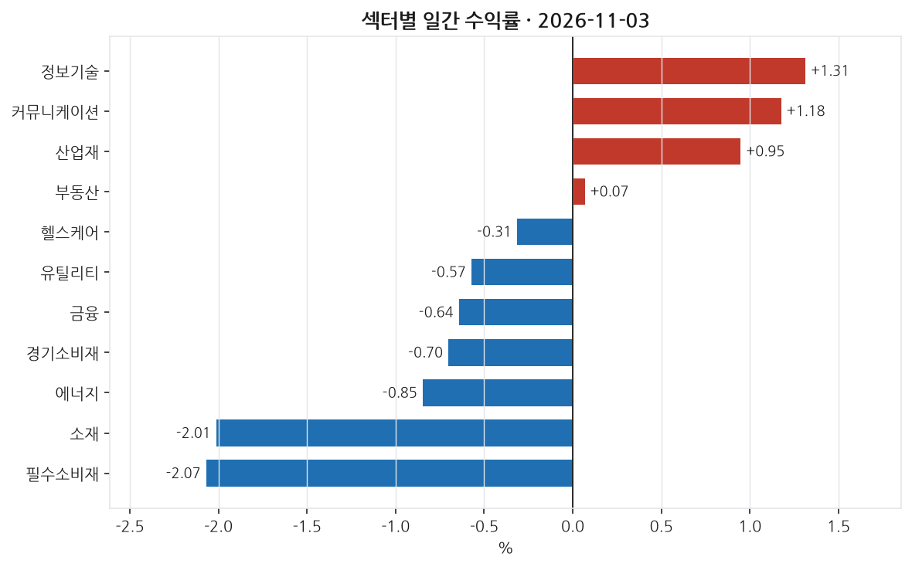
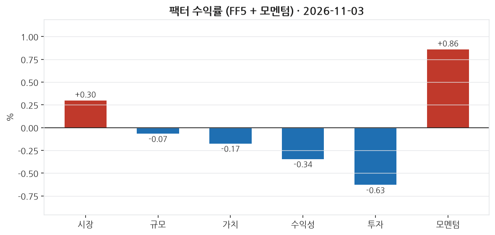
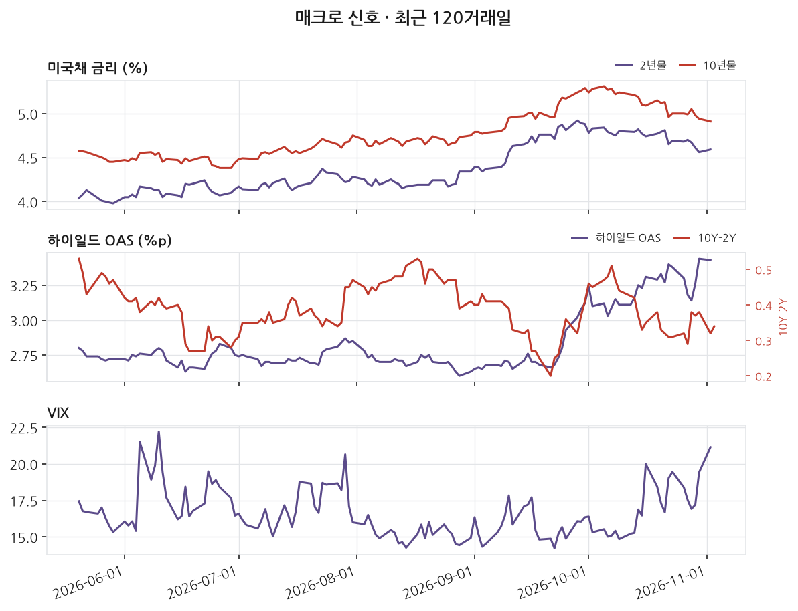
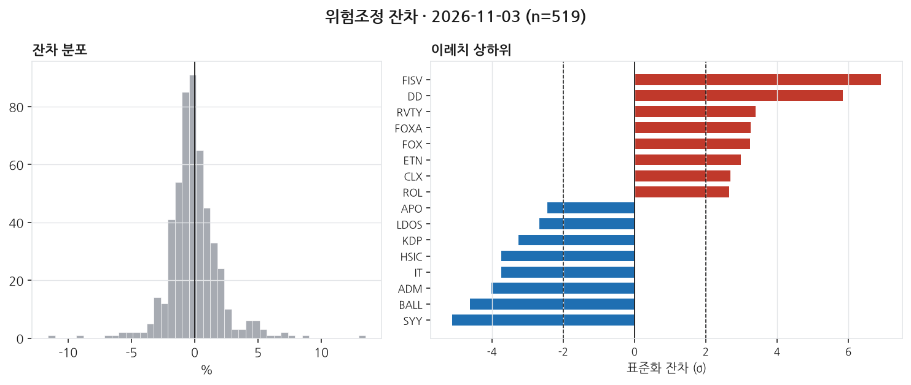

# 2026-11-03 | SPY +0.30% — 이례치 28종목

> 대상 거래일 2026년 11월 03일 (ET) · 발행 2026-11-04 07:00 KST

---

## 1. 무엇이 움직였나

_이 블록은 숫자만 적는다. 해석은 2번으로 넘긴다._

| 지수 | 일간 |
|---|---|
| S&P 500 (SPY) | +0.30% |
| 나스닥 100 (QQQ) | +0.62% |
| 러셀 2000 (IWM) | +0.23% |
| 다우 30 (DIA) | -0.44% |

11개 섹터 중 4개 상승. 최상위 정보기술 +1.31%, 최하위 필수소비재 -2.07%. 상하단 폭 3.38%p.

| 신호 | 레벨 | 직전대비 | 기준일 |
|---|---|---|---|
| 2년물 | 4.59 | +3bp | 11-02 (미공개) |
| 10년물 | 4.91 | -3bp | 11-02 (미공개) |
| 10Y-2Y | 0.34 | +2bp | 11-03 |
| 기대인플레(10Y BEI) | 2.30 | +1bp | 11-03 |
| 달러지수 | 121.67 | -0.07 | 10-30 (미공개) |
| VIX | 21.15 | +1.73 | 11-02 (미공개) |
| 하이일드 OAS | 3.43 | -1bp | 11-02 (미공개) |
| EFFR | 3.88 | +0bp | 11-02 (미공개) |

_'미공개'는 해당 거래일 값이 아직 FRED에 공개되지 않아 직전 공개일 기준임을 뜻한다. 확정치가 들어오면 소급 갱신된다._

---

## 2. 무엇이 설명했나

_개별 종목의 등락은 대부분 '그 종목 고유의 사건'이 아니라 시장 전체·규모·가치·모멘텀 같은 **공통 요인(팩터)** 에 대한 노출로 설명된다. 이 블록은 그 공통 요인이 그날 얼마나 움직였는지를 먼저 본다._

모멘텀 팩터는 0.86% 오르며 가장 두드러진 움직임을 보였다. 이는 최근 상승했던 종목들이 계속해서 주가가 오른 날이라는 것을 의미한다. 반면, 가치(저평가주에서 성장주를 뺀 수익), 수익성, 투자 팩터는 모두 음수로, 각각 -0.17%, -0.34%, -0.62% 하락했다. 이는 성장주와 영업수익성이 낮은 기업, 그리고 자본을 적극적으로 사용하는 기업들이 우위를 보인 상황이었다고 해석할 수 있다.

섹터에서는 정보기술과 커뮤니케이션 섹터가 각각 1.31%와 1.18% 상승하며 두드러진 성과를 냈다. 이는 시장 변동성을 지나치게 의식하지 않은 섹터 중심 장세가 있었음을 시사한다. 반면, 필수소비재와 소재 섹터는 각각 -2.07%와 -2.01%로 가장 큰 하락폭을 보였다. 이는 시장 상승세가 모든 섹터에 동일하게 반영되지 않고, 특정 섹터는 오히려 상대적으로 저조했음을 나타낸다.

개별 종목에서는 금융 섹터에 속한 Fiserv가 13.49%의 잔차 수익을 기록하며 돋보였다. 이는 팩터 노출로 설명되지 않는 개별 종목의 강세였다. 대조적으로, 필수소비재에 있는 Sysco는 -9.14%의 잔차 수익을 보여 큰 폭으로 하락했다. 이는 해당 섹터나 팩터 외적인 개별 요인이 작용했을 가능성을 암시한다. '읽을 거리'로 소재와 필수소비재의 섹터 하락폭을 들 수 있다. 시장 팩터가 소폭 상승했음에도 불구하고 이들 섹터는 큰 폭으로 하락하며, 단순히 시장 전반 상승으로는 설명되지 않는 특정 산업 내 고유의 불안정성이 존재했음을 시사한다.

_**모멘텀(UMD) +0.86%** — 최근 약 1년간 많이 오른 종목을 사고 많이 내린 종목을 파는 가상 포트폴리오의 그날 수익률이다. **양(+)이다. 오르던 종목이 그날도 더 올랐다는 뜻이다(추세 지속). 최근 상승 종목에 몰려 있던 자금에 유리했던 날이다.** 이 팩터를 모형에 넣지 않으면 이 움직임이 잔차에 남아 뉴스 효과로 오인된다._

---

## 3. 설명되지 않은 움직임

_**잔차(residual)** 는 '그 종목이 팩터 노출만으로 움직였다면 이랬을 텐데, 실제로는 이만큼 달랐다'의 차이다. 예를 들어 시장이 -1.5% 빠진 날 어떤 종목이 -1.5% 하락했다면 시장을 따라간 것이라 잔차는 0에 가깝다. 반대로 시장이 빠진 날 +16% 오르면 팩터로 설명되지 않는 큰 양(+)의 잔차가 남는다. 그 남은 부분이 그 종목 고유의 사건 — 실적 발표, 가이던스 수정, M&A 같은 — 을 담고 있을 가능성이 높다. 이 블로그가 뉴스와 맞춰보는 대상이 바로 이 잔차다._

위험모형: ff5_umd · 추정창 250거래일 · 유효 종목 519개. 잔차 표준편차 207bp.

±2σ 이탈: 상방 12개, 하방 16개 (전체 519개 중 5.4%). **z** 는 그 종목의 잔차를 자기 과거 변동성으로 나눈 값이다. z=+3이면 평소 흔들림의 세 배만큼 위로 벗어났다는 뜻이고, 정규분포라면 ±2σ 밖은 약 4.6%만 나온다 — 그보다 많으면 그날 개별 사건이 몰렸거나 수익률 분포의 꼬리가 두껍다는 신호다.

| 종목 | 회사 | 섹터 | 수익률 | 잔차 | z | 같은 날 보도된 뉴스 |
|---|---|---|---|---|---|---|
| FISV | Fiserv | 금융 | +12.46% | +13.49% | +6.9 | **미설명** |
| DD | DuPont | 산업재 | +8.61% | +8.66% | +5.8 | **미설명** |
| RVTY | Revvity | 헬스케어 | +7.84% | +7.70% | +3.4 | **미설명** |
| FOXA | Fox Corporation (Class A) | 커뮤니케이션 | +6.92% | +7.33% | +3.3 | **미설명** |
| FOX | Fox Corporation (Class B) | 커뮤니케이션 | +6.56% | +6.99% | +3.2 | **미설명** |
| SYY | Sysco | 필수소비재 | -9.33% | -9.14% | -5.1 | **미설명** |
| BALL | Ball Corporation | 소재 | -7.14% | -6.54% | -4.6 | **미설명** |
| ADM | Archer Daniels Midland | 필수소비재 | -6.82% | -6.66% | -4.0 | **미설명** |
| IT | Gartner | 정보기술 | -13.19% | -11.57% | -3.7 | **미설명** |
| HSIC | Henry Schein | 헬스케어 | -4.76% | -4.52% | -3.7 | **미설명** |

이례치 상하위 20종목 중 19개는 수집 범위 안에서 매칭되는 뉴스를 찾지 못했다. 뉴스 커버리지 한계이거나, 실제로 뉴스가 아닌 요인일 수 있다. 둘을 구분하지 않고 '뉴스로 설명되지 않는다'고 단정하지 않는다.

---

## 4. 어제 신호 채점

_이 블로그의 존재 이유다. 전날 뉴스 감성으로 종목을 5분위로 나눠 놓고, 그 다음 거래일에 실제로 상위 분위가 하위 분위보다 높은 잔차를 냈는지 채점한다. **맞은 날과 틀린 날을 모두 그대로 남긴다.** 사후에 성공 사례만 고르면 out-of-sample 기록이 아니게 되기 때문이다._

직전 거래일 뉴스 감성(novelty 가중) 5분위 포트폴리오의 당일 실현 잔차:

- 최상위 분위 (n=8): +40.8bp
- 최하위 분위 (n=8): +65.6bp
- 스프레드: **-24.8bp** (방향 불일치)

누적 47거래일: 평균 스프레드 +7.8bp, 방향 적중률 45%, t=0.85.

동일가중이며 거래비용을 반영하지 않았다. 집행 가능한 전략 수익률이 아니라 신호의 방향성 기록이다.

---

## 5. 다음 거래일 일정

_아래는 다음 거래일에 공개되는 주요 지표다. 여기 있는 항목은 **전 종목의 잔차가 같은 방향으로 움직이기 쉬운 날**을 미리 표시해 둔 것이다. 그런 날은 개별 뉴스 효과와 매크로 충격이 섞여 3번 블록의 해석이 어려워진다(횡단면 상관이 커진다). 전망이 아니라 해석 난이도에 대한 예고다._

| 발표일 | 지표 | 왜 중요한가 |
|---|---|---|
| 2026-11-04 | FOMC 성명 | 정책금리 결정. 전 종목 잔차가 같은 방향으로 움직이는 대표적인 날 |
| 2026-11-05 | 주간 신규 실업수당 청구 | 주 단위로 나오는 유일한 고용 지표. 고빈도 경기 체크 |
| 2026-11-06 | 고용보고서 (비농업 취업자·실업률) | 연준 정책 판단의 1순위 입력. 서프라이즈가 금리 곡선 전체를 움직인다 |

_일정은 FRED 릴리스 캘린더 기준이며 시각은 지표마다 다르다. 컨센서스(시장 예상치)는 무료 소스로 확보되지 않아 싣지 않는다._

---

_본 글은 공개 데이터를 자동 수집·분석한 연구 기록이며 투자자문이 아닙니다. 특정 종목의 매수·매도를 권유하지 않으며, 필자는 언급된 종목을 보유하고 있을 수 있습니다. 모든 수치는 발행 시점 기준이며 사후 수정될 수 있습니다._

데이터 출처: Yahoo Finance · FRED (St. Louis Fed) · Kenneth R. French Data Library · SEC EDGAR

생성 커밋: `0060fa0`