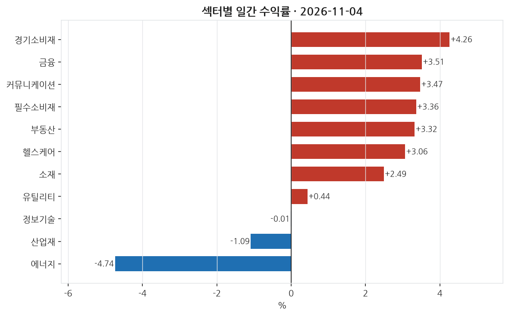
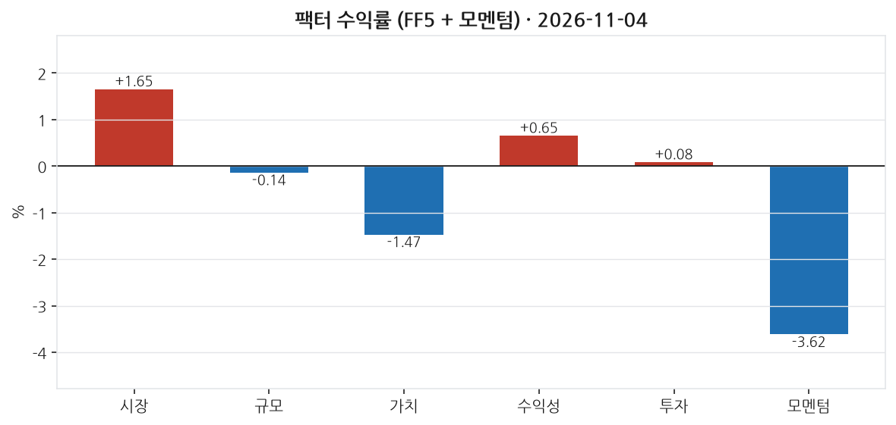
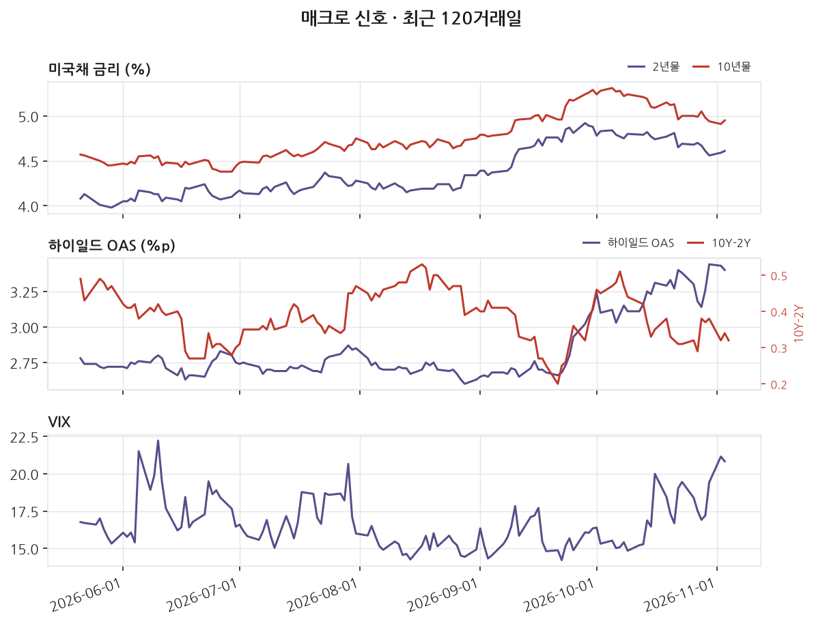
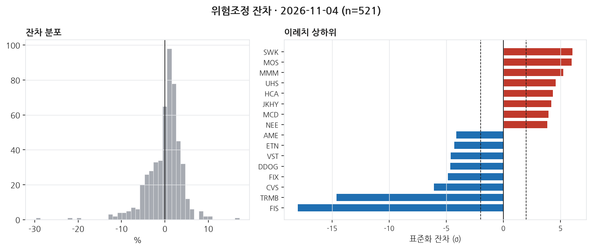

# 2026-11-04 | SPY +1.65% — 이례치 144종목

> 대상 거래일 2026년 11월 04일 (ET) · 발행 2026-11-05 07:00 KST

---

## 1. 무엇이 움직였나

_이 블록은 숫자만 적는다. 해석은 2번으로 넘긴다._

| 지수 | 일간 |
|---|---|
| S&P 500 (SPY) | +1.65% |
| 나스닥 100 (QQQ) | +0.97% |
| 러셀 2000 (IWM) | +1.51% |
| 다우 30 (DIA) | +3.10% |

11개 섹터 중 8개 상승. 최상위 경기소비재 +4.26%, 최하위 에너지 -4.74%. 상하단 폭 9.00%p.

| 신호 | 레벨 | 직전대비 | 기준일 |
|---|---|---|---|
| 2년물 | 4.61 | +2bp | 11-03 (미공개) |
| 10년물 | 4.95 | +4bp | 11-03 (미공개) |
| 10Y-2Y | 0.32 | -2bp | 11-04 |
| 기대인플레(10Y BEI) | 2.26 | -4bp | 11-04 |
| 달러지수 | 121.67 | -0.07 | 10-30 (미공개) |
| VIX | 20.83 | -0.32 | 11-03 (미공개) |
| 하이일드 OAS | 3.40 | -3bp | 11-03 (미공개) |
| EFFR | 3.88 | +0bp | 11-03 (미공개) |

_'미공개'는 해당 거래일 값이 아직 FRED에 공개되지 않아 직전 공개일 기준임을 뜻한다. 확정치가 들어오면 소급 갱신된다._

---

## 2. 무엇이 설명했나

_개별 종목의 등락은 대부분 '그 종목 고유의 사건'이 아니라 시장 전체·규모·가치·모멘텀 같은 **공통 요인(팩터)** 에 대한 노출로 설명된다. 이 블록은 그 공통 요인이 그날 얼마나 움직였는지를 먼저 본다._

모멘텀 팩터는 -3.62% 수준으로 상당히 크게 하락했다. 이는 최근 12개월 동안 상승률이 높았던 종목들이 이날 하락하며 추세가 되돌려졌다는 의미다. 반면, 시장 팩터는 1.65%로 증가하여, 그날 대부분의 주식 시장 움직임이 전체 시장 방향으로 설명된다는 것을 보여준다. 이와 함께, 소형주로부터 대형주로 자금이 조금 이동하고, 성장주가 우위를 차지했다는 점도 눈에 띈다.

섹터별로는 경기소비재가 4.26%로 가장 큰 상승폭을 보였고, 그 뒤로 금융, 커뮤니케이션, 필수소비재 등의 순으로 높은 수익을 기록했다. 반면, 에너지 섹터는 -4.74%로 가장 큰 하락을 겪었다. 주목할 점은 시장이 전반적으로 상승했음에도 불구하고 섹터별 변동폭이 비교적 컸다는 점이다.

특정 종목 중에서는 Mosaic Company (소재)이 17.37%의 높은 상승률을 기록하며, 이는 팩터 노출로 설명하지 못하는 미설명 상승의 큰 부분을 차지했다. 반면, Fidelity National Information Services (금융)은 -23.67%로 하락하며 미설명 하락의 사례가 되었다. 잔차의 평균 분산은 약 4.09%p로, 이는 주식별로 내재된 변동성이 상당했음을 보여준다. in-sample R²는 적시되지 않아 설명할 수 없는 부분의 존재가 의심될 수 있다.

_**모멘텀(UMD) -3.62%** — 최근 약 1년간 많이 오른 종목을 사고 많이 내린 종목을 파는 가상 포트폴리오의 그날 수익률이다. **음(−)이다. 최근 잘 오르던 종목이 그날 오히려 더 많이 빠졌다는 뜻이다(되돌림). 최근 상승세가 강한 종목을 들고 있었다면 개별 뉴스가 없어도 손실이 났을 날이다.** 이 팩터를 모형에 넣지 않으면 이 움직임이 잔차에 남아 뉴스 효과로 오인된다._

---

## 3. 설명되지 않은 움직임

_**잔차(residual)** 는 '그 종목이 팩터 노출만으로 움직였다면 이랬을 텐데, 실제로는 이만큼 달랐다'의 차이다. 예를 들어 시장이 -1.5% 빠진 날 어떤 종목이 -1.5% 하락했다면 시장을 따라간 것이라 잔차는 0에 가깝다. 반대로 시장이 빠진 날 +16% 오르면 팩터로 설명되지 않는 큰 양(+)의 잔차가 남는다. 그 남은 부분이 그 종목 고유의 사건 — 실적 발표, 가이던스 수정, M&A 같은 — 을 담고 있을 가능성이 높다. 이 블로그가 뉴스와 맞춰보는 대상이 바로 이 잔차다._

위험모형: ff5_umd · 추정창 250거래일 · 유효 종목 521개. 잔차 표준편차 409bp.

±2σ 이탈: 상방 77개, 하방 67개 (전체 521개 중 27.6%). **z** 는 그 종목의 잔차를 자기 과거 변동성으로 나눈 값이다. z=+3이면 평소 흔들림의 세 배만큼 위로 벗어났다는 뜻이고, 정규분포라면 ±2σ 밖은 약 4.6%만 나온다 — 그보다 많으면 그날 개별 사건이 몰렸거나 수익률 분포의 꼬리가 두껍다는 신호다.

| 종목 | 회사 | 섹터 | 수익률 | 잔차 | z | 같은 날 보도된 뉴스 |
|---|---|---|---|---|---|---|
| SWK | Stanley Black & Decker | 산업재 | +13.10% | +10.35% | +6.1 | **미설명** |
| MOS | Mosaic Company (The) | 소재 | +17.37% | +17.16% | +6.0 | **미설명** |
| MMM | 3M | 산업재 | +9.55% | +7.84% | +5.3 | **미설명** |
| UHS | Universal Health Services | 헬스케어 | +10.91% | +9.24% | +4.6 | **미설명** |
| HCA | HCA Healthcare | 헬스케어 | +10.34% | +8.38% | +4.3 | **미설명** |
| FIS | Fidelity National Information Services | 금융 | -23.67% | -29.71% | -18.0 | **미설명** |
| TRMB | Trimble Inc. | 정보기술 | -17.31% | -22.37% | -14.6 | **미설명** |
| CVS | CVS Health | 헬스케어 | -12.53% | -12.59% | -6.1 | **미설명** |
| FIX | Comfort Systems USA | 산업재 | -15.08% | -11.14% | -4.8 | **미설명** |
| DDOG | Datadog | 정보기술 | -14.42% | -19.62% | -4.7 | **미설명** |

이례치 상하위 20종목 중 18개는 수집 범위 안에서 매칭되는 뉴스를 찾지 못했다. 뉴스 커버리지 한계이거나, 실제로 뉴스가 아닌 요인일 수 있다. 둘을 구분하지 않고 '뉴스로 설명되지 않는다'고 단정하지 않는다.

---

## 4. 어제 신호 채점

_이 블로그의 존재 이유다. 전날 뉴스 감성으로 종목을 5분위로 나눠 놓고, 그 다음 거래일에 실제로 상위 분위가 하위 분위보다 높은 잔차를 냈는지 채점한다. **맞은 날과 틀린 날을 모두 그대로 남긴다.** 사후에 성공 사례만 고르면 out-of-sample 기록이 아니게 되기 때문이다._

직전 거래일 뉴스 감성(novelty 가중) 5분위 포트폴리오의 당일 실현 잔차:

- 최상위 분위 (n=6): +130.1bp
- 최하위 분위 (n=6): +86.5bp
- 스프레드: **+43.6bp** (방향 일치)

누적 48거래일: 평균 스프레드 +8.5bp, 방향 적중률 46%, t=0.95.

동일가중이며 거래비용을 반영하지 않았다. 집행 가능한 전략 수익률이 아니라 신호의 방향성 기록이다.

---

## 5. 다음 거래일 일정

_아래는 다음 거래일에 공개되는 주요 지표다. 여기 있는 항목은 **전 종목의 잔차가 같은 방향으로 움직이기 쉬운 날**을 미리 표시해 둔 것이다. 그런 날은 개별 뉴스 효과와 매크로 충격이 섞여 3번 블록의 해석이 어려워진다(횡단면 상관이 커진다). 전망이 아니라 해석 난이도에 대한 예고다._

| 발표일 | 지표 | 왜 중요한가 |
|---|---|---|
| 2026-11-05 | FOMC 성명 | 정책금리 결정. 전 종목 잔차가 같은 방향으로 움직이는 대표적인 날 |
| 2026-11-05 | 주간 신규 실업수당 청구 | 주 단위로 나오는 유일한 고용 지표. 고빈도 경기 체크 |
| 2026-11-06 | 고용보고서 (비농업 취업자·실업률) | 연준 정책 판단의 1순위 입력. 서프라이즈가 금리 곡선 전체를 움직인다 |

_일정은 FRED 릴리스 캘린더 기준이며 시각은 지표마다 다르다. 컨센서스(시장 예상치)는 무료 소스로 확보되지 않아 싣지 않는다._

---

_본 글은 공개 데이터를 자동 수집·분석한 연구 기록이며 투자자문이 아닙니다. 특정 종목의 매수·매도를 권유하지 않으며, 필자는 언급된 종목을 보유하고 있을 수 있습니다. 모든 수치는 발행 시점 기준이며 사후 수정될 수 있습니다._

데이터 출처: Yahoo Finance · FRED (St. Louis Fed) · Kenneth R. French Data Library · SEC EDGAR

생성 커밋: `1041e36`