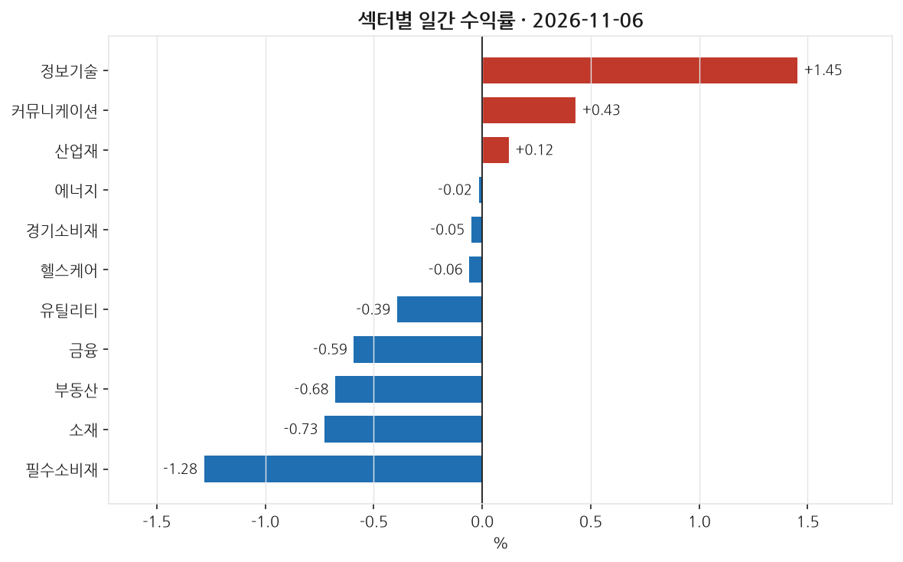
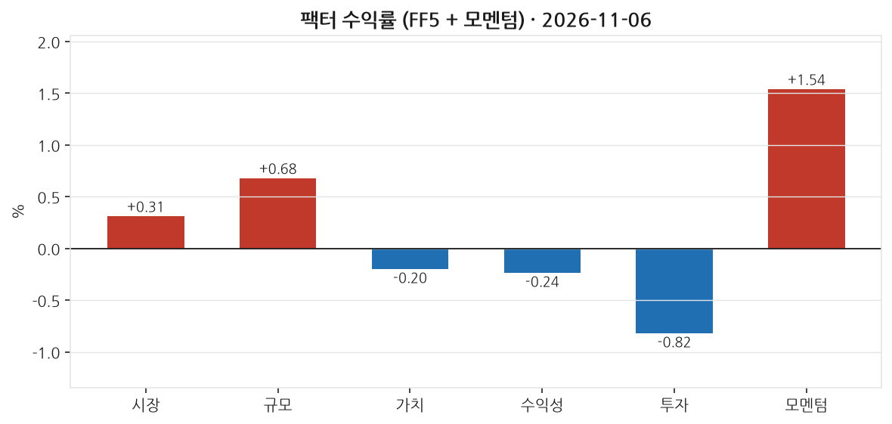
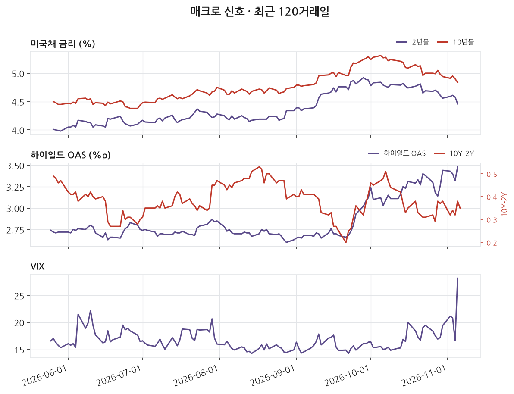
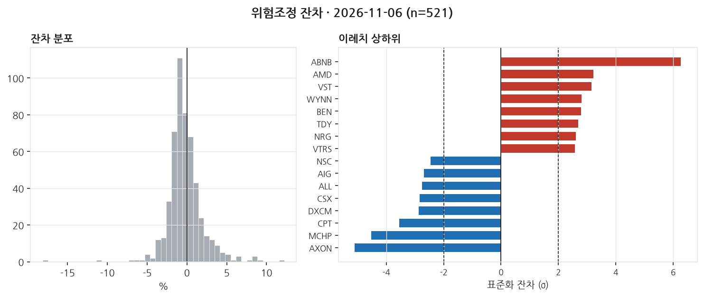

# 2026-11-06 | SPY +0.31% — 이례치 28종목

> 대상 거래일 2026년 11월 06일 (ET) · 발행 2026-11-07 07:00 KST

---

## 1. 무엇이 움직였나

_이 블록은 숫자만 적는다. 해석은 2번으로 넘긴다._

| 지수 | 일간 |
|---|---|
| S&P 500 (SPY) | +0.31% |
| 나스닥 100 (QQQ) | +1.40% |
| 러셀 2000 (IWM) | +0.99% |
| 다우 30 (DIA) | -0.40% |

11개 섹터 중 3개 상승. 최상위 정보기술 +1.45%, 최하위 필수소비재 -1.28%. 상하단 폭 2.74%p.

| 신호 | 레벨 | 직전대비 | 기준일 |
|---|---|---|---|
| 2년물 | 4.46 | -12bp | 11-05 (미공개) |
| 10년물 | 4.84 | -6bp | 11-05 (미공개) |
| 10Y-2Y | 0.35 | -3bp | 11-06 |
| 기대인플레(10Y BEI) | 2.23 | -1bp | 11-06 |
| 달러지수 | 121.67 | -0.07 | 10-30 (미공개) |
| VIX | 28.18 | +11.57 | 11-05 (미공개) |
| 하이일드 OAS | 3.48 | +16bp | 11-05 (미공개) |
| EFFR | 3.88 | +0bp | 11-05 (미공개) |

_'미공개'는 해당 거래일 값이 아직 FRED에 공개되지 않아 직전 공개일 기준임을 뜻한다. 확정치가 들어오면 소급 갱신된다._

---

## 2. 무엇이 설명했나

_개별 종목의 등락은 대부분 '그 종목 고유의 사건'이 아니라 시장 전체·규모·가치·모멘텀 같은 **공통 요인(팩터)** 에 대한 노출로 설명된다. 이 블록은 그 공통 요인이 그날 얼마나 움직였는지를 먼저 본다._

모멘텀 팩터는 1.54% 상승하며 가장 큰 변동을 보였다. 이는 최근 12개월 내 상승률이 높은 종목들이 그 상승세를 이어가고 있음을 보여준다. 시장 팩터도 소폭으로 플러스(0.31%)였다. 소형주 주도로 주식가격이 오른 날이었다. 가치와 수익성도 소폭 감소해 성장주가 가치주보다, 저수익 기업이 수익성 높은 기업보다 선호된 것으로 보인다. 반면, 투자 팩터는 -0.82%로 가장 부진했는데 이는 자본을 보수적으로 배분하는 기업보다 많이 하는 기업이 더 나은 수익을 냈다는 뜻이다.

섹터별로는 정보기술이 1.45%로 가장 높은 성과를 보였고, 그 다음은 커뮤니케이션과 산업재가 각각 0.43%, 0.12%로 이어졌다. 이에 반해 필수소비재는 -1.28%로 가장 낮은 수익률을 기록하였다. 이는 개별 섹터의 수익률이 시장 팩터보다 넓은 변동성을 보였다는 것을 의미한다. 특히, 가치와 모멘텀의 경향이 오늘 움직임에 영향을 준 것으로 보인다.

개별 종목으로 보면, Airbnb와 Advanced Micro Devices가 각각 경기소비재와 정보기술 섹터 내에서 가장 높은 잔차를 기록하며 강세를 보였다. 반대로, 산업재 섹터의 Axon Enterprise가 큰 손실을 봤다. 전체적으로 28개 뉴스 주제가 분석되었으나, in-sample R²가 주어지지 않아 해석할 수 있는 자료가 부족했다. 이는 팩터 모델로 설명하지 못한 변동이 시장에 존재했음을 시사한다. 평소 하루의 변동 폭이 약 2.3%p였던 점을 고려할 때, 이날의 변동성은 상위 잔차와 하위 잔차의 표준편차가 거의 2배로 커져 있음을 보여준다. 이는 정보가 흘러 들어감에 따른 불안정성을 의미할 수 있다.

_**모멘텀(UMD) +1.54%** — 최근 약 1년간 많이 오른 종목을 사고 많이 내린 종목을 파는 가상 포트폴리오의 그날 수익률이다. **양(+)이다. 오르던 종목이 그날도 더 올랐다는 뜻이다(추세 지속). 최근 상승 종목에 몰려 있던 자금에 유리했던 날이다.** 이 팩터를 모형에 넣지 않으면 이 움직임이 잔차에 남아 뉴스 효과로 오인된다._

---

## 3. 설명되지 않은 움직임

_**잔차(residual)** 는 '그 종목이 팩터 노출만으로 움직였다면 이랬을 텐데, 실제로는 이만큼 달랐다'의 차이다. 예를 들어 시장이 -1.5% 빠진 날 어떤 종목이 -1.5% 하락했다면 시장을 따라간 것이라 잔차는 0에 가깝다. 반대로 시장이 빠진 날 +16% 오르면 팩터로 설명되지 않는 큰 양(+)의 잔차가 남는다. 그 남은 부분이 그 종목 고유의 사건 — 실적 발표, 가이던스 수정, M&A 같은 — 을 담고 있을 가능성이 높다. 이 블로그가 뉴스와 맞춰보는 대상이 바로 이 잔차다._

위험모형: ff5_umd · 추정창 250거래일 · 유효 종목 521개. 잔차 표준편차 230bp.

±2σ 이탈: 상방 15개, 하방 13개 (전체 521개 중 5.4%). **z** 는 그 종목의 잔차를 자기 과거 변동성으로 나눈 값이다. z=+3이면 평소 흔들림의 세 배만큼 위로 벗어났다는 뜻이고, 정규분포라면 ±2σ 밖은 약 4.6%만 나온다 — 그보다 많으면 그날 개별 사건이 몰렸거나 수익률 분포의 꼬리가 두껍다는 신호다.

| 종목 | 회사 | 섹터 | 수익률 | 잔차 | z | 같은 날 보도된 뉴스 |
|---|---|---|---|---|---|---|
| ABNB | Airbnb | 경기소비재 | +11.67% | +12.23% | +6.3 | **미설명** |
| AMD | Advanced Micro Devices | 정보기술 | +11.04% | +8.39% | +3.2 | **미설명** |
| VST | Vistra Corp. | 유틸리티 | +10.55% | +8.65% | +3.2 | **미설명** |
| WYNN | Wynn Resorts | 경기소비재 | +4.78% | +4.96% | +2.8 | [10-Q - WYNN RESORTS LTD (0001174922) (Filer)](https://www.sec.gov/Archives/edgar/data/1174922/000117492226000079/0001174922-26-000079-index.htm) _SEC 10-Q_ |
| BEN | Franklin Resources | 금융 | +4.72% | +3.80% | +2.8 | **미설명** |
| AXON | Axon Enterprise | 산업재 | -18.18% | -18.12% | -5.1 | [8-K - AXON ENTERPRISE, INC. (0001069183) (Filer)](https://www.sec.gov/Archives/edgar/data/1069183/000162828026071150/0001628280-26-071150-index.htm) _SEC 8-K_ |
| MCHP | Microchip Technology | 정보기술 | -10.02% | -10.77% | -4.5 | **미설명** |
| CPT | Camden Property Trust | 부동산 | -4.12% | -3.75% | -3.5 | **미설명** |
| DXCM | Dexcom | 헬스케어 | -5.98% | -6.25% | -2.9 | **미설명** |
| CSX | CSX Corporation | 산업재 | -3.36% | -3.76% | -2.8 | **미설명** |

이례치 상하위 20종목 중 16개는 수집 범위 안에서 매칭되는 뉴스를 찾지 못했다. 뉴스 커버리지 한계이거나, 실제로 뉴스가 아닌 요인일 수 있다. 둘을 구분하지 않고 '뉴스로 설명되지 않는다'고 단정하지 않는다.

---

## 4. 어제 신호 채점

_이 블로그의 존재 이유다. 전날 뉴스 감성으로 종목을 5분위로 나눠 놓고, 그 다음 거래일에 실제로 상위 분위가 하위 분위보다 높은 잔차를 냈는지 채점한다. **맞은 날과 틀린 날을 모두 그대로 남긴다.** 사후에 성공 사례만 고르면 out-of-sample 기록이 아니게 되기 때문이다._

직전 거래일 뉴스 감성(novelty 가중) 5분위 포트폴리오의 당일 실현 잔차:

- 최상위 분위 (n=6): +47.5bp
- 최하위 분위 (n=6): +102.5bp
- 스프레드: **-55.0bp** (방향 불일치)

누적 50거래일: 평균 스프레드 +6.3bp, 방향 적중률 44%, t=0.72.

동일가중이며 거래비용을 반영하지 않았다. 집행 가능한 전략 수익률이 아니라 신호의 방향성 기록이다.

---

## 5. 다음 거래일 일정

_아래는 다음 거래일에 공개되는 주요 지표다. 여기 있는 항목은 **전 종목의 잔차가 같은 방향으로 움직이기 쉬운 날**을 미리 표시해 둔 것이다. 그런 날은 개별 뉴스 효과와 매크로 충격이 섞여 3번 블록의 해석이 어려워진다(횡단면 상관이 커진다). 전망이 아니라 해석 난이도에 대한 예고다._

| 발표일 | 지표 | 왜 중요한가 |
|---|---|---|
| 2026-11-07 | FOMC 성명 | 정책금리 결정. 전 종목 잔차가 같은 방향으로 움직이는 대표적인 날 |
| 2026-11-10 | 소비자물가지수 (CPI) | 인플레이션 지표 중 시장 반응이 가장 크다. 실질금리 기대를 바꾼다 |

_일정은 FRED 릴리스 캘린더 기준이며 시각은 지표마다 다르다. 컨센서스(시장 예상치)는 무료 소스로 확보되지 않아 싣지 않는다._

---

_본 글은 공개 데이터를 자동 수집·분석한 연구 기록이며 투자자문이 아닙니다. 특정 종목의 매수·매도를 권유하지 않으며, 필자는 언급된 종목을 보유하고 있을 수 있습니다. 모든 수치는 발행 시점 기준이며 사후 수정될 수 있습니다._

데이터 출처: Yahoo Finance · FRED (St. Louis Fed) · Kenneth R. French Data Library · SEC EDGAR

생성 커밋: `d29881c`