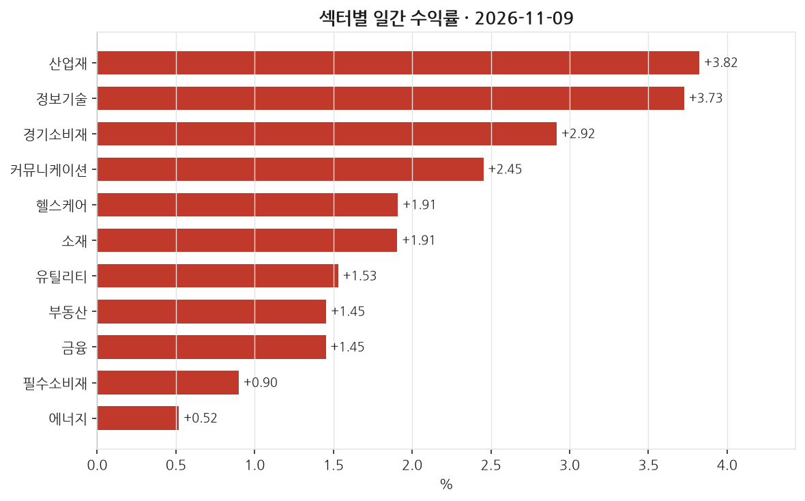
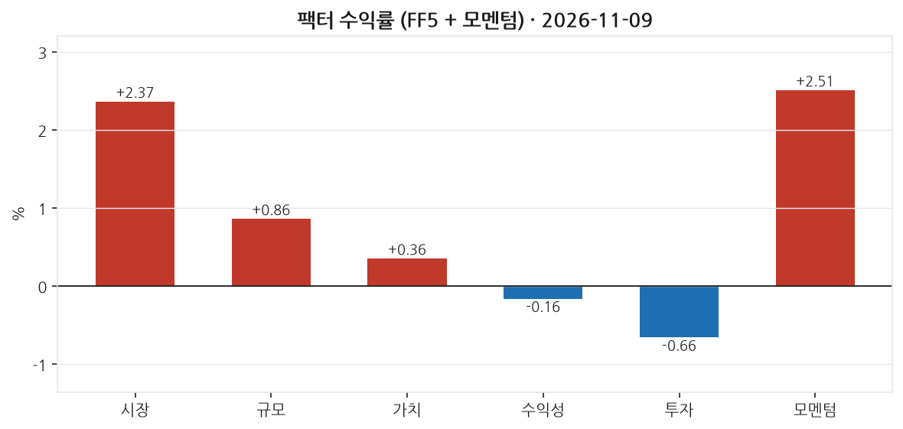
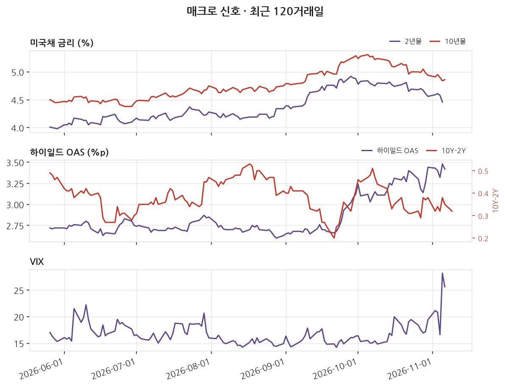
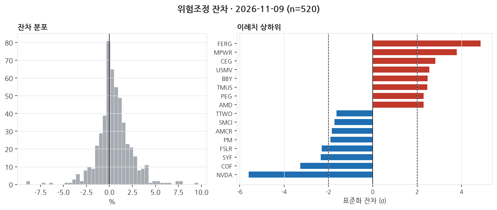

# 2026-11-09 | SPY +2.37% — 이례치 18종목

> 대상 거래일 2026년 11월 09일 (ET) · 발행 2026-11-10 07:00 KST

---

## 1. 무엇이 움직였나

_이 블록은 숫자만 적는다. 해석은 2번으로 넘긴다._

| 지수 | 일간 |
|---|---|
| S&P 500 (SPY) | +2.37% |
| 나스닥 100 (QQQ) | +3.54% |
| 러셀 2000 (IWM) | +3.23% |
| 다우 30 (DIA) | +2.17% |

11개 섹터 중 11개 상승. 최상위 산업재 +3.82%, 최하위 에너지 +0.52%. 상하단 폭 3.30%p.

| 신호 | 레벨 | 직전대비 | 기준일 |
|---|---|---|---|
| 2년물 | 4.46 | -12bp | 11-05 (미공개) |
| 10년물 | 4.86 | +2bp | 11-06 (미공개) |
| 10Y-2Y | 0.32 | -3bp | 11-09 |
| 기대인플레(10Y BEI) | 2.23 | -1bp | 11-06 (미공개) |
| 달러지수 | 121.88 | +0.37 | 11-06 (미공개) |
| VIX | 25.64 | -2.54 | 11-06 (미공개) |
| 하이일드 OAS | 3.42 | -6bp | 11-06 (미공개) |
| EFFR | 3.88 | +0bp | 11-06 (미공개) |

_'미공개'는 해당 거래일 값이 아직 FRED에 공개되지 않아 직전 공개일 기준임을 뜻한다. 확정치가 들어오면 소급 갱신된다._

---

## 2. 무엇이 설명했나

_개별 종목의 등락은 대부분 '그 종목 고유의 사건'이 아니라 시장 전체·규모·가치·모멘텀 같은 **공통 요인(팩터)** 에 대한 노출로 설명된다. 이 블록은 그 공통 요인이 그날 얼마나 움직였는지를 먼저 본다._

팩터 측면에서 보면, 시장 팩터(전체 초과수익)가 2.37%로 높아 전체 시장의 상승이 개별 종목 이슈보다 시장 전반의 긍정적 영향으로 설명될 수 있었다. 모멘텀 팩터는 2.51%로 상승했는데, 이는 최근 12개월 동안 주가가 많이 오른 종목들이 추가적으로 상승한 날을 의미한다. 소형주의 상대적 강세를 나타내는 규모(SMB) 팩터 또한 0.86%로 상승했으며, 이는 소형주가 대형주보다 더 좋은 성과를 낸 날이었다고 해석할 수 있다. 가치(HML) 팩터는 소폭 상승했지만, 수익성(RMW)과 투자(CMA) 팩터는 각각 하락하며, 수익성과 보수적 자본배분이 상대적으로 덜 선호받았음을 시사한다.

섹터별로는 산업재(3.82%)와 정보기술(3.73%) 부문이 두드러진 상승세를 보였다. 이는 전체 시장 상승률 대비 상당히 높은 수준이다. 반면에 에너지 섹터는 0.52%로 가장 적게 상승했다. 개별 종목 중에서는 Monolithic Power Systems(정보기술)과 Advanced Micro Devices(정보기술)가 각각 16.6%와 13.3% 상승하며 가장 큰 상승폭을 기록했다. 반대로 Nvidia(정보기술)는 4.3% 하락했고, 이처럼 큰 하락은 팩터로 설명되지 않고 잔차로 남았다. 이는 팩터 노출로 설명되지 않는 뉴스나 이슈가 있었을 수 있음을 암시한다.

토픽 회귀에서는 설명력(R²)이 null로, in-sample 분석에서 데이터를 통해 유의하게 설명되지 않았음을 나타낸다. 이는 방대한 주제적 요인들로 인해 구체적 설명이 어려운 상황이었거나, 데이터 커버리지의 한계로 인해 설명되지 않은 부분이 발생했을 수 있다. 평균 잔차가 50.46bp로 이는 특정 종목들이 팩터로 수익을 설명하지 못한 폭이 컸으며, 이는 약 0.5%p에 해당한다는 점을 보여준다. 특이하게도 금융섹터의 일부 종목들은 상대적으로 낮은 성과를 기록했음을 알 수 있다. 이는 다양한 외부 요인들이 결합하여 나타난 현상으로 확인된다.

_**모멘텀(UMD) +2.51%** — 최근 약 1년간 많이 오른 종목을 사고 많이 내린 종목을 파는 가상 포트폴리오의 그날 수익률이다. **양(+)이다. 오르던 종목이 그날도 더 올랐다는 뜻이다(추세 지속). 최근 상승 종목에 몰려 있던 자금에 유리했던 날이다.** 이 팩터를 모형에 넣지 않으면 이 움직임이 잔차에 남아 뉴스 효과로 오인된다._

---

## 3. 설명되지 않은 움직임

_**잔차(residual)** 는 '그 종목이 팩터 노출만으로 움직였다면 이랬을 텐데, 실제로는 이만큼 달랐다'의 차이다. 예를 들어 시장이 -1.5% 빠진 날 어떤 종목이 -1.5% 하락했다면 시장을 따라간 것이라 잔차는 0에 가깝다. 반대로 시장이 빠진 날 +16% 오르면 팩터로 설명되지 않는 큰 양(+)의 잔차가 남는다. 그 남은 부분이 그 종목 고유의 사건 — 실적 발표, 가이던스 수정, M&A 같은 — 을 담고 있을 가능성이 높다. 이 블로그가 뉴스와 맞춰보는 대상이 바로 이 잔차다._

위험모형: ff5_umd · 추정창 250거래일 · 유효 종목 520개. 잔차 표준편차 193bp.

±2σ 이탈: 상방 14개, 하방 4개 (전체 520개 중 3.5%). **z** 는 그 종목의 잔차를 자기 과거 변동성으로 나눈 값이다. z=+3이면 평소 흔들림의 세 배만큼 위로 벗어났다는 뜻이고, 정규분포라면 ±2σ 밖은 약 4.6%만 나온다 — 그보다 많으면 그날 개별 사건이 몰렸거나 수익률 분포의 꼬리가 두껍다는 신호다.

| 종목 | 회사 | 섹터 | 수익률 | 잔차 | z | 같은 날 보도된 뉴스 |
|---|---|---|---|---|---|---|
| FERG | Ferguson Enterprises | 산업재 | +11.22% | +7.65% | +4.9 | **미설명** |
| MPWR | Monolithic Power Systems | 정보기술 | +16.60% | +9.63% | +3.8 | **미설명** |
| CEG | Constellation Energy | 유틸리티 | +10.46% | +7.94% | +2.8 | **미설명** |
| USMV | USMV |  | +1.71% | +0.90% | +2.5 | **미설명** |
| BBY | Best Buy | 경기소비재 | +6.67% | +5.49% | +2.5 | **미설명** |
| NVDA | Nvidia | 정보기술 | -4.27% | -9.05% | -5.6 | [Nvidia, AMD and other chip stocks rebound — but is r…](https://www.marketwatch.com/story/nvidia-amd-and-other-chip-stocks-rebound-is-the-violent-ai-selloff-over-8f7df533?mod=mw_rss_topstories) _MarketWatch Top_ |
| COF | Capital One | 금융 | -1.63% | -4.79% | -3.3 | **미설명** |
| SYF | Synchrony Financial | 금융 | -0.71% | -3.66% | -2.3 | **미설명** |
| FSLR | First Solar | 정보기술 | -4.74% | -7.04% | -2.3 | **미설명** |
| PM | Philip Morris International | 필수소비재 | -2.41% | -3.27% | -1.9 | **미설명** |

이례치 상하위 20종목 중 17개는 수집 범위 안에서 매칭되는 뉴스를 찾지 못했다. 뉴스 커버리지 한계이거나, 실제로 뉴스가 아닌 요인일 수 있다. 둘을 구분하지 않고 '뉴스로 설명되지 않는다'고 단정하지 않는다.

---

## 4. 어제 신호 채점

_이 블로그의 존재 이유다. 전날 뉴스 감성으로 종목을 5분위로 나눠 놓고, 그 다음 거래일에 실제로 상위 분위가 하위 분위보다 높은 잔차를 냈는지 채점한다. **맞은 날과 틀린 날을 모두 그대로 남긴다.** 사후에 성공 사례만 고르면 out-of-sample 기록이 아니게 되기 때문이다._

직전 거래일 뉴스 감성(novelty 가중) 5분위 포트폴리오의 당일 실현 잔차:

- 최상위 분위 (n=6): -42.2bp
- 최하위 분위 (n=6): +78.7bp
- 스프레드: **-120.9bp** (방향 불일치)

누적 51거래일: 평균 스프레드 +3.9bp, 방향 적중률 43%, t=0.43.

동일가중이며 거래비용을 반영하지 않았다. 집행 가능한 전략 수익률이 아니라 신호의 방향성 기록이다.

---

## 5. 다음 거래일 일정

_아래는 다음 거래일에 공개되는 주요 지표다. 여기 있는 항목은 **전 종목의 잔차가 같은 방향으로 움직이기 쉬운 날**을 미리 표시해 둔 것이다. 그런 날은 개별 뉴스 효과와 매크로 충격이 섞여 3번 블록의 해석이 어려워진다(횡단면 상관이 커진다). 전망이 아니라 해석 난이도에 대한 예고다._

| 발표일 | 지표 | 왜 중요한가 |
|---|---|---|
| 2026-11-10 | FOMC 성명 | 정책금리 결정. 전 종목 잔차가 같은 방향으로 움직이는 대표적인 날 |
| 2026-11-10 | 소비자물가지수 (CPI) | 인플레이션 지표 중 시장 반응이 가장 크다. 실질금리 기대를 바꾼다 |
| 2026-11-12 | 주간 신규 실업수당 청구 | 주 단위로 나오는 유일한 고용 지표. 고빈도 경기 체크 |
| 2026-11-13 | 생산자물가지수 (PPI) | 기업 투입비용. 마진 압박 경로로 실적 기대에 반영된다 |

_일정은 FRED 릴리스 캘린더 기준이며 시각은 지표마다 다르다. 컨센서스(시장 예상치)는 무료 소스로 확보되지 않아 싣지 않는다._

---

_본 글은 공개 데이터를 자동 수집·분석한 연구 기록이며 투자자문이 아닙니다. 특정 종목의 매수·매도를 권유하지 않으며, 필자는 언급된 종목을 보유하고 있을 수 있습니다. 모든 수치는 발행 시점 기준이며 사후 수정될 수 있습니다._

데이터 출처: Yahoo Finance · FRED (St. Louis Fed) · Kenneth R. French Data Library · SEC EDGAR

생성 커밋: `1bfedfc`