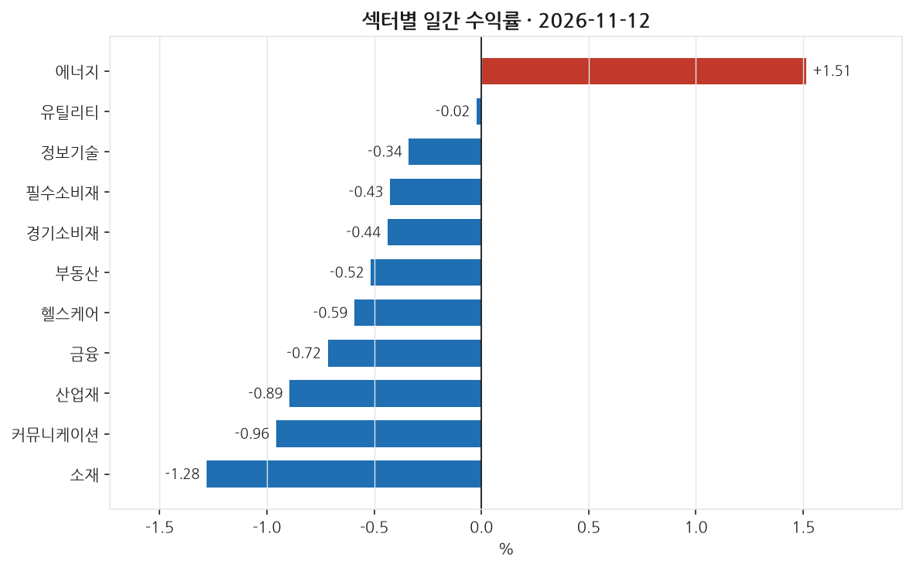
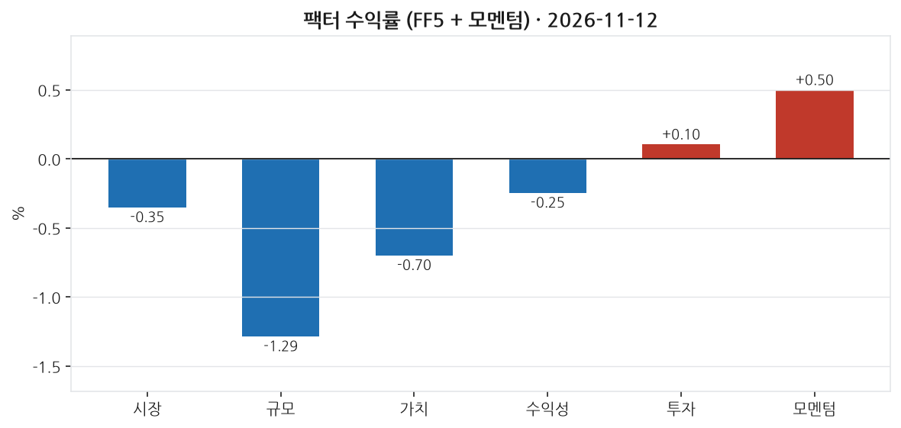
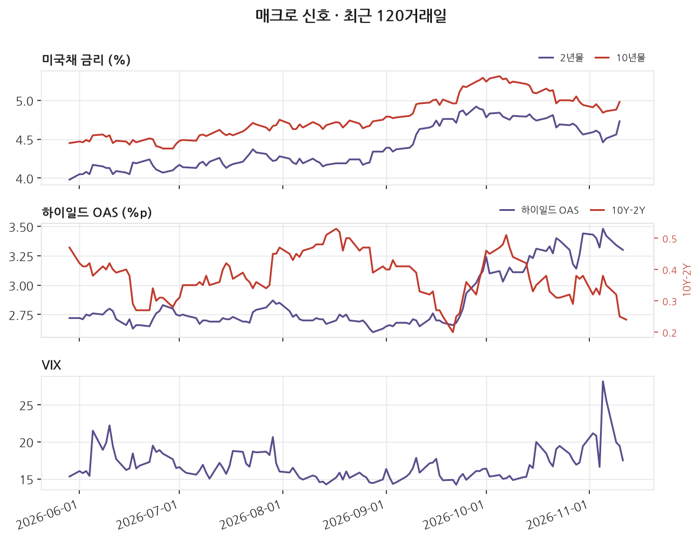
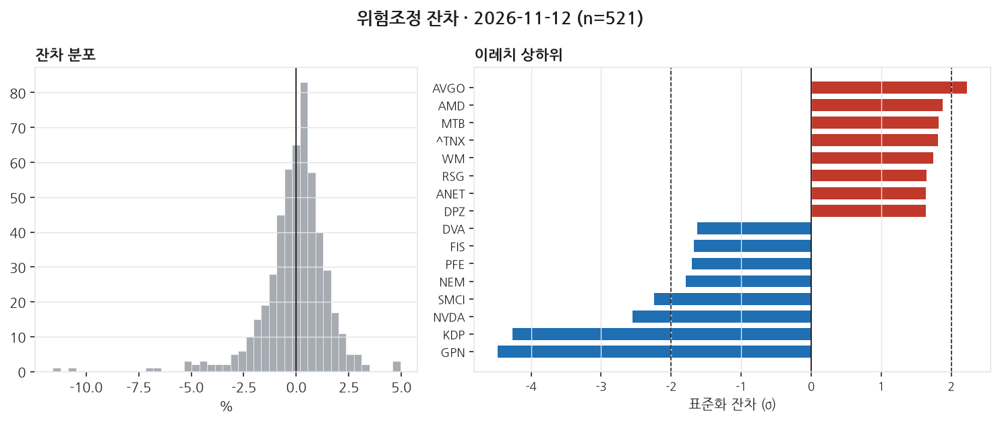

# 2026-11-12 | SPY -0.35% — 이례치 5종목

> 대상 거래일 2026년 11월 12일 (ET) · 발행 2026-11-13 07:00 KST

---

## 1. 무엇이 움직였나

_이 블록은 숫자만 적는다. 해석은 2번으로 넘긴다._

| 지수 | 일간 |
|---|---|
| S&P 500 (SPY) | -0.35% |
| 나스닥 100 (QQQ) | -0.32% |
| 러셀 2000 (IWM) | -1.64% |
| 다우 30 (DIA) | -0.38% |

11개 섹터 중 1개 상승. 최상위 에너지 +1.51%, 최하위 소재 -1.28%. 상하단 폭 2.80%p.

| 신호 | 레벨 | 직전대비 | 기준일 |
|---|---|---|---|
| 2년물 | 4.73 | +17bp | 11-10 (미공개) |
| 10년물 | 4.98 | +10bp | 11-10 (미공개) |
| 10Y-2Y | 0.24 | -1bp | 11-12 |
| 기대인플레(10Y BEI) | 2.24 | +4bp | 11-12 |
| 달러지수 | 121.88 | +0.37 | 11-06 (미공개) |
| VIX | 17.49 | -1.97 | 11-11 (미공개) |
| 하이일드 OAS | 3.30 | -4bp | 11-11 (미공개) |
| EFFR | 3.88 | +0bp | 11-11 (미공개) |

_'미공개'는 해당 거래일 값이 아직 FRED에 공개되지 않아 직전 공개일 기준임을 뜻한다. 확정치가 들어오면 소급 갱신된다._

---

## 2. 무엇이 설명했나

_개별 종목의 등락은 대부분 '그 종목 고유의 사건'이 아니라 시장 전체·규모·가치·모멘텀 같은 **공통 요인(팩터)** 에 대한 노출로 설명된다. 이 블록은 그 공통 요인이 그날 얼마나 움직였는지를 먼저 본다._

시장은 전체적으로 하락세를 보였다. 시장 팩터는 -0.35%로, 시장 전반이 약세를 보인 하루였음을 시사한다. 규모 팩터는 -1.29%로, 대형주가 소형주보다 상대적으로 더 선호된 날이었다. 가치와 수익성 팩터도 각각 -0.70%와 -0.25%로 하락한 반면, CMA 팩터는 보합세(+0.10%)에 가까웠다. 모멘텀 팩터는 +0.50%로 상승해, 최근 상승세를 보인 종목이 계속해서 오르는 경향을 보였다.

섹터별로는 에너지 섹터가 1.51%로 유일하게 상승한 반면, 소재와 커뮤니케이션 섹터는 각각 -1.28%와 -0.96%로 큰 폭으로 하락했다. 특히 산업재와 금융 섹터도 각각 -0.90%와 -0.72%를 기록하는 등 대체로 하락세가 두드러졌다. 이는 시장 하락세가 특정 섹터보다는 전반적으로 확산되어 있음을 시사한다.

개별 종목 중에서는 정보기술 분야의 Broadcom과 Advanced Micro Devices가 각각 +5.54%와 +5.86% 상승했고, 이는 팩터 노출로 설명하기 어려운 부분이 많은, 즉 잔차가 큰 상승이었다. 반면, 금융 부문의 Global Payments는 -12.01%로 큰 하락을 보이며 잔차도 컸다. 모델은 in-sample 자료로부터 521개 종목 중 10개의 가장 큰 잔차를 가진 종목을 관찰했으나, 명확한 설명력을 제공하지 않았으므로 이들은 특정 개별 이슈에 반응한 것으로 보인다. 이는 주어진 데이터 커버리지의 한계일 수 있다.

_**모멘텀(UMD) +0.50%** — 최근 약 1년간 많이 오른 종목을 사고 많이 내린 종목을 파는 가상 포트폴리오의 그날 수익률이다. **양(+)이다. 오르던 종목이 그날도 더 올랐다는 뜻이다(추세 지속). 최근 상승 종목에 몰려 있던 자금에 유리했던 날이다.** 이 팩터를 모형에 넣지 않으면 이 움직임이 잔차에 남아 뉴스 효과로 오인된다._

---

## 3. 설명되지 않은 움직임

_**잔차(residual)** 는 '그 종목이 팩터 노출만으로 움직였다면 이랬을 텐데, 실제로는 이만큼 달랐다'의 차이다. 예를 들어 시장이 -1.5% 빠진 날 어떤 종목이 -1.5% 하락했다면 시장을 따라간 것이라 잔차는 0에 가깝다. 반대로 시장이 빠진 날 +16% 오르면 팩터로 설명되지 않는 큰 양(+)의 잔차가 남는다. 그 남은 부분이 그 종목 고유의 사건 — 실적 발표, 가이던스 수정, M&A 같은 — 을 담고 있을 가능성이 높다. 이 블로그가 뉴스와 맞춰보는 대상이 바로 이 잔차다._

위험모형: ff5_umd · 추정창 250거래일 · 유효 종목 521개. 잔차 표준편차 159bp.

±2σ 이탈: 상방 1개, 하방 4개 (전체 521개 중 1.0%). **z** 는 그 종목의 잔차를 자기 과거 변동성으로 나눈 값이다. z=+3이면 평소 흔들림의 세 배만큼 위로 벗어났다는 뜻이고, 정규분포라면 ±2σ 밖은 약 4.6%만 나온다 — 그보다 많으면 그날 개별 사건이 몰렸거나 수익률 분포의 꼬리가 두껍다는 신호다.

| 종목 | 회사 | 섹터 | 수익률 | 잔차 | z | 같은 날 보도된 뉴스 |
|---|---|---|---|---|---|---|
| AVGO | Broadcom | 정보기술 | +5.54% | +4.62% | +2.2 | **미설명** |
| AMD | Advanced Micro Devices | 정보기술 | +5.86% | +4.95% | +1.9 | **미설명** |
| MTB | M&T Bank | 금융 | -0.19% | +1.68% | +1.8 | **미설명** |
| ^TNX | ^TNX |  | +2.10% | +1.54% | +1.8 | **미설명** |
| WM | Waste Management | 산업재 | +1.59% | +2.08% | +1.7 | **미설명** |
| GPN | Global Payments | 금융 | -12.01% | -10.56% | -4.5 | **미설명** |
| KDP | Keurig Dr Pepper | 필수소비재 | -7.40% | -6.82% | -4.3 | **미설명** |
| NVDA | Nvidia | 정보기술 | -4.34% | -4.49% | -2.6 | [Nasdaq futures fall as Nvidia sinks 8% after hours o…](https://www.marketwatch.com/story/nasdaq-futures-fall-as-nvidia-sinks-8-after-hours-on-report-board-may-oust-huang-e99b898d?mod=mw_rss_topstories) _MarketWatch Top_ |
| SMCI | Supermicro | 정보기술 | -11.30% | -11.59% | -2.2 | **미설명** |
| NEM | Newmont | 소재 | -4.92% | -4.85% | -1.8 | **미설명** |

이례치 상하위 20종목 중 19개는 수집 범위 안에서 매칭되는 뉴스를 찾지 못했다. 뉴스 커버리지 한계이거나, 실제로 뉴스가 아닌 요인일 수 있다. 둘을 구분하지 않고 '뉴스로 설명되지 않는다'고 단정하지 않는다.

---

## 4. 어제 신호 채점

_이 블로그의 존재 이유다. 전날 뉴스 감성으로 종목을 5분위로 나눠 놓고, 그 다음 거래일에 실제로 상위 분위가 하위 분위보다 높은 잔차를 냈는지 채점한다. **맞은 날과 틀린 날을 모두 그대로 남긴다.** 사후에 성공 사례만 고르면 out-of-sample 기록이 아니게 되기 때문이다._

채점에 필요한 직전 거래일 신호가 부족하다. 누적 데이터가 쌓이면 자동으로 채워진다.

---

## 5. 다음 거래일 일정

_아래는 다음 거래일에 공개되는 주요 지표다. 여기 있는 항목은 **전 종목의 잔차가 같은 방향으로 움직이기 쉬운 날**을 미리 표시해 둔 것이다. 그런 날은 개별 뉴스 효과와 매크로 충격이 섞여 3번 블록의 해석이 어려워진다(횡단면 상관이 커진다). 전망이 아니라 해석 난이도에 대한 예고다._

| 발표일 | 지표 | 왜 중요한가 |
|---|---|---|
| 2026-11-13 | FOMC 성명 | 정책금리 결정. 전 종목 잔차가 같은 방향으로 움직이는 대표적인 날 |
| 2026-11-13 | 생산자물가지수 (PPI) | 기업 투입비용. 마진 압박 경로로 실적 기대에 반영된다 |
| 2026-11-13 | 주간 신규 실업수당 청구 | 주 단위로 나오는 유일한 고용 지표. 고빈도 경기 체크 |
| 2026-11-17 | 산업생산·설비가동률 | 제조업 실물 활동. 경기 순환 국면 확인 |
| 2026-11-17 | 소매판매 | 미국 GDP의 약 3분의 2가 소비다. 경기소비재 섹터에 직접 반영된다 |

_일정은 FRED 릴리스 캘린더 기준이며 시각은 지표마다 다르다. 컨센서스(시장 예상치)는 무료 소스로 확보되지 않아 싣지 않는다._

---

_본 글은 공개 데이터를 자동 수집·분석한 연구 기록이며 투자자문이 아닙니다. 특정 종목의 매수·매도를 권유하지 않으며, 필자는 언급된 종목을 보유하고 있을 수 있습니다. 모든 수치는 발행 시점 기준이며 사후 수정될 수 있습니다._

데이터 출처: Yahoo Finance · FRED (St. Louis Fed) · Kenneth R. French Data Library · SEC EDGAR

생성 커밋: `068e361`