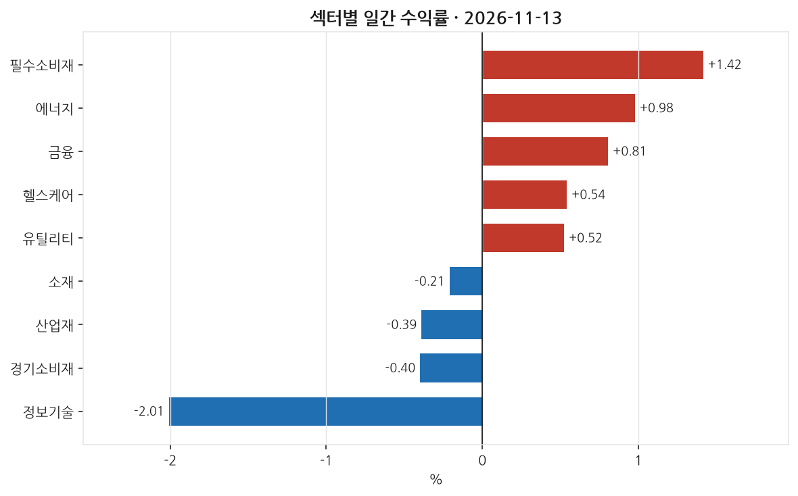
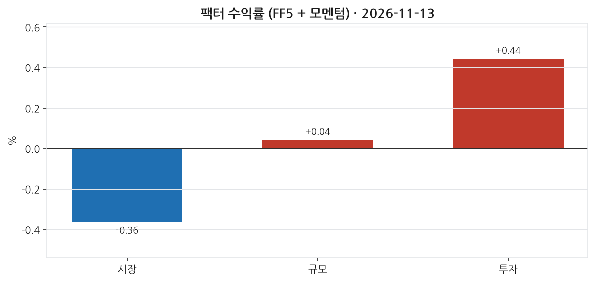
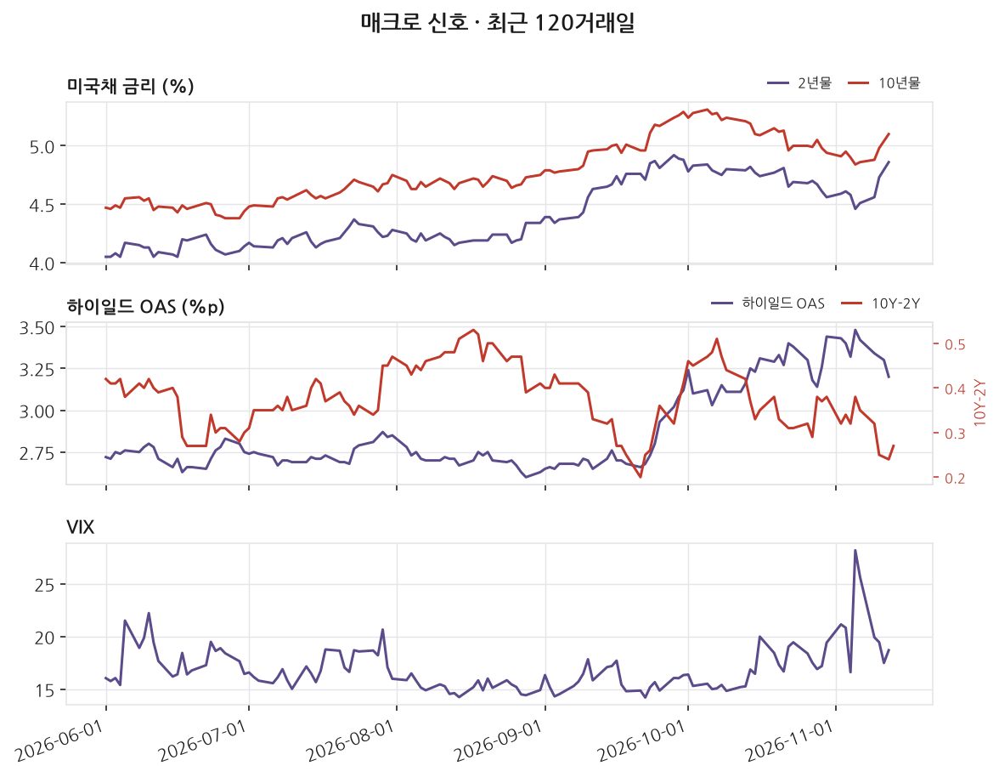

# 2026-11-13 | SPY -0.36%

> 대상 거래일 2026년 11월 13일 (ET) · 발행 2026-11-14 07:00 KST

---

## 1. 무엇이 움직였나

_이 블록은 숫자만 적는다. 해석은 2번으로 넘긴다._

| 지수 | 일간 |
|---|---|
| S&P 500 (SPY) | -0.36% |
| 나스닥 100 (QQQ) | -1.20% |
| 러셀 2000 (IWM) | -0.32% |
| 다우 30 (DIA) | +0.13% |

11개 섹터 중 5개 상승. 최상위 필수소비재 +1.42%, 최하위 정보기술 -2.01%. 상하단 폭 3.43%p.

| 신호 | 레벨 | 직전대비 | 기준일 |
|---|---|---|---|
| 2년물 | 4.86 | +13bp | 11-12 (미공개) |
| 10년물 | 5.10 | +12bp | 11-12 (미공개) |
| 10Y-2Y | 0.27 | +3bp | 11-13 |
| 기대인플레(10Y BEI) | 2.24 | +0bp | 11-13 |
| 달러지수 | 121.88 | +0.37 | 11-06 (미공개) |
| VIX | 18.70 | +1.21 | 11-12 (미공개) |
| 하이일드 OAS | 3.20 | -10bp | 11-12 (미공개) |
| EFFR | 3.88 | +0bp | 11-12 (미공개) |

_'미공개'는 해당 거래일 값이 아직 FRED에 공개되지 않아 직전 공개일 기준임을 뜻한다. 확정치가 들어오면 소급 갱신된다._

---

## 2. 무엇이 설명했나

_개별 종목의 등락은 대부분 '그 종목 고유의 사건'이 아니라 시장 전체·규모·가치·모멘텀 같은 **공통 요인(팩터)** 에 대한 노출로 설명된다. 이 블록은 그 공통 요인이 그날 얼마나 움직였는지를 먼저 본다._

시장을 나타내는 팩터는 -0.36%로 소폭 하락했다. 이는 시장 전체의 방향성이 약간 부정적이었음을 의미한다. 규모 팩터는 소폭 상승하여 소형주가 대형주에 비해 약간의 우위를 보였다. 반면, 투자 팩터는 0.44%로 더 확연히 상승하여, 보수적으로 자본을 배분하는 기업들이 그날의 수익성을 더 높게 기록한 날이었다.

섹터별로는 필수소비재가 1.42% 상승하여 가장 강력한 모습을 보였고, 에너지와 금융도 상승하였다. 그러나 정보기술 섹터는 2.01% 하락하며 가장 큰 폭의 하락세를 보였다. 이는 달리 설명되지 않는 반면에, 다른 섹터들은 상대적으로 서로 재는 움직임을 보였다.

토픽 회귀 분석에서는 유의미한 데이터를 얻지 못했다. 이는 새로운 뉴스나 이벤트가 주식 가격에 미치는 영향을 제대로 포착하지 못한 결과일 수 있다. 데이터 커버리지의 한계가 있을 수 있으며, 이 점을 염두에 두어야 할 것이다.

---

## 3. 설명되지 않은 움직임

잔차 계산에 필요한 최소 관측치를 확보하지 못했다.

---

## 4. 어제 신호 채점

_이 블로그의 존재 이유다. 전날 뉴스 감성으로 종목을 5분위로 나눠 놓고, 그 다음 거래일에 실제로 상위 분위가 하위 분위보다 높은 잔차를 냈는지 채점한다. **맞은 날과 틀린 날을 모두 그대로 남긴다.** 사후에 성공 사례만 고르면 out-of-sample 기록이 아니게 되기 때문이다._

채점에 필요한 직전 거래일 신호가 부족하다. 누적 데이터가 쌓이면 자동으로 채워진다.

---

## 5. 다음 거래일 일정

_아래는 다음 거래일에 공개되는 주요 지표다. 여기 있는 항목은 **전 종목의 잔차가 같은 방향으로 움직이기 쉬운 날**을 미리 표시해 둔 것이다. 그런 날은 개별 뉴스 효과와 매크로 충격이 섞여 3번 블록의 해석이 어려워진다(횡단면 상관이 커진다). 전망이 아니라 해석 난이도에 대한 예고다._

| 발표일 | 지표 | 왜 중요한가 |
|---|---|---|
| 2026-11-14 | FOMC 성명 | 정책금리 결정. 전 종목 잔차가 같은 방향으로 움직이는 대표적인 날 |
| 2026-11-17 | 산업생산·설비가동률 | 제조업 실물 활동. 경기 순환 국면 확인 |
| 2026-11-17 | 소매판매 | 미국 GDP의 약 3분의 2가 소비다. 경기소비재 섹터에 직접 반영된다 |
| 2026-11-18 | 주택 착공·허가 | 금리에 가장 민감한 실물 부문. 건자재 종목에 직접 반영된다 |

_일정은 FRED 릴리스 캘린더 기준이며 시각은 지표마다 다르다. 컨센서스(시장 예상치)는 무료 소스로 확보되지 않아 싣지 않는다._

---

_본 글은 공개 데이터를 자동 수집·분석한 연구 기록이며 투자자문이 아닙니다. 특정 종목의 매수·매도를 권유하지 않으며, 필자는 언급된 종목을 보유하고 있을 수 있습니다. 모든 수치는 발행 시점 기준이며 사후 수정될 수 있습니다._

데이터 출처: Yahoo Finance · FRED (St. Louis Fed) · Kenneth R. French Data Library · SEC EDGAR

생성 커밋: `07b2f73`