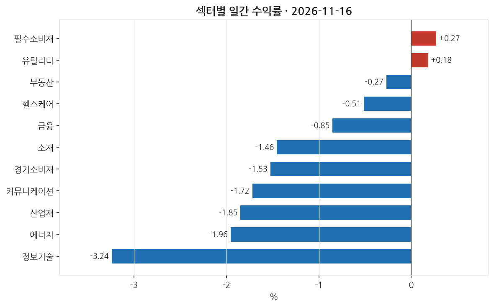
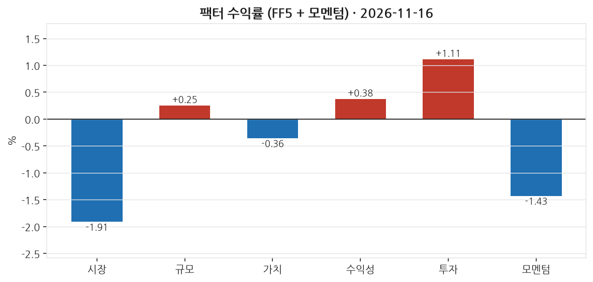
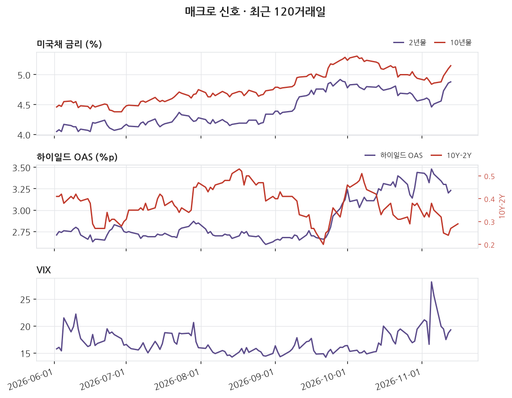
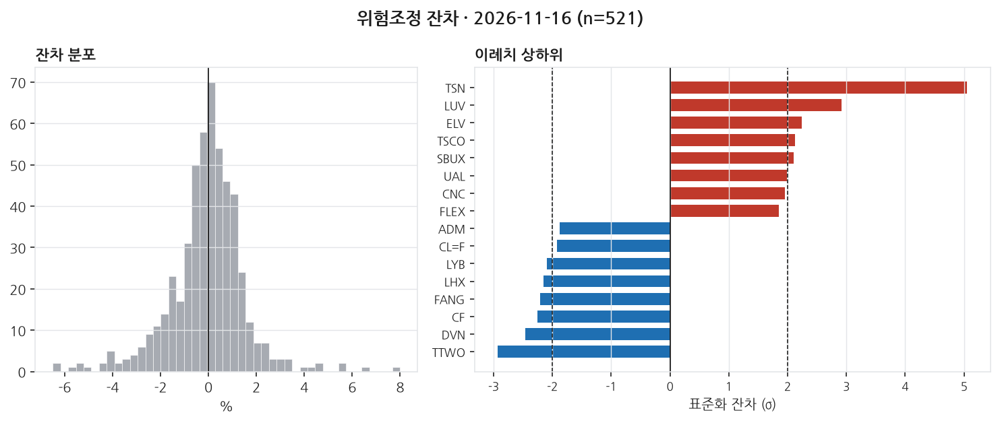

# 2026-11-16 | SPY -1.91% — 이례치 11종목

> 대상 거래일 2026년 11월 16일 (ET) · 발행 2026-11-17 07:00 KST

---

## 1. 무엇이 움직였나

_이 블록은 숫자만 적는다. 해석은 2번으로 넘긴다._

| 지수 | 일간 |
|---|---|
| S&P 500 (SPY) | -1.91% |
| 나스닥 100 (QQQ) | -2.67% |
| 러셀 2000 (IWM) | -1.66% |
| 다우 30 (DIA) | -1.43% |

11개 섹터 중 2개 상승. 최상위 필수소비재 +0.27%, 최하위 정보기술 -3.24%. 상하단 폭 3.51%p.

| 신호 | 레벨 | 직전대비 | 기준일 |
|---|---|---|---|
| 2년물 | 4.88 | +2bp | 11-13 (미공개) |
| 10년물 | 5.15 | +5bp | 11-13 (미공개) |
| 10Y-2Y | 0.29 | +2bp | 11-16 |
| 기대인플레(10Y BEI) | 2.20 | -4bp | 11-16 |
| 달러지수 | 122.65 | +0.11 | 11-13 (미공개) |
| VIX | 19.30 | +0.60 | 11-13 (미공개) |
| 하이일드 OAS | 3.23 | +3bp | 11-13 (미공개) |
| EFFR | 3.88 | +0bp | 11-13 (미공개) |

_'미공개'는 해당 거래일 값이 아직 FRED에 공개되지 않아 직전 공개일 기준임을 뜻한다. 확정치가 들어오면 소급 갱신된다._

---

## 2. 무엇이 설명했나

_개별 종목의 등락은 대부분 '그 종목 고유의 사건'이 아니라 시장 전체·규모·가치·모멘텀 같은 **공통 요인(팩터)** 에 대한 노출로 설명된다. 이 블록은 그 공통 요인이 그날 얼마나 움직였는지를 먼저 본다._

그날 시장 팩터는 -1.91%로 전체 초과수익이 하락세에 있었음을 보여주었다. 특히 모멘텀 팩터가 -1.43%로 크게 움직였고, 이는 최근 상승하던 종목들이 하락하며 추세가 되돌려진 날이었다는 것을 의미한다. 가치 팩터는 -0.36%로 성장주가 우위에 있었고, 규모 팩터는 소폭 상승하여 소형주가 대형주 대비 다소 우세했다. 수익성 팩터는 0.38%로 질적 우위 선호가 있었고, 투자 팩터는 1.11%로 보수적 자본 배분 기업이 상대적으로 강세를 보였다.

개별 섹터 중에서는 필수소비재가 0.27%로 선방한 반면, 정보기술과 에너지 섹터가 각각 -3.24%와 -1.95%를 기록하며 가장 큰 하락폭을 보였다. 이는 시장 하락세에 따라 섹터간 변동이 크게 나타났다는 점을 시사한다. 개별 종목 중에서는 필수소비재에 속한 Tyson Foods와 Southwest Airlines가 각각 8.7%, 3.3% 상승하며 도드라지는 성과를 보였다. 반면, 게임 개발업체 Take-Two Interactive는 커뮤니케이션 섹터 내에서 -6.30% 하락하며 큰 잔차를 남겼다.

토픽 회귀 분석에서는 특이한 계수가 관측되지 않았고, 설명력에 관한 R²도 제공되지 않았다. 이는 데이터를 통한 잔차 설명이 그날의 움직임을 충분히 포착하지 못하고 있음을 의미한다. 이는 접근 가능한 데이터의 범위와 정확성에 의한 제약일 수 있다. 전체적으로 그날 시장의 등락은 모멘텀의 반전과 정보기술 및 에너지 섹터의 하락이 큰 영향을 미쳤음을 보여준다.

_**모멘텀(UMD) -1.43%** — 최근 약 1년간 많이 오른 종목을 사고 많이 내린 종목을 파는 가상 포트폴리오의 그날 수익률이다. **음(−)이다. 최근 잘 오르던 종목이 그날 오히려 더 많이 빠졌다는 뜻이다(되돌림). 최근 상승세가 강한 종목을 들고 있었다면 개별 뉴스가 없어도 손실이 났을 날이다.** 이 팩터를 모형에 넣지 않으면 이 움직임이 잔차에 남아 뉴스 효과로 오인된다._

---

## 3. 설명되지 않은 움직임

_**잔차(residual)** 는 '그 종목이 팩터 노출만으로 움직였다면 이랬을 텐데, 실제로는 이만큼 달랐다'의 차이다. 예를 들어 시장이 -1.5% 빠진 날 어떤 종목이 -1.5% 하락했다면 시장을 따라간 것이라 잔차는 0에 가깝다. 반대로 시장이 빠진 날 +16% 오르면 팩터로 설명되지 않는 큰 양(+)의 잔차가 남는다. 그 남은 부분이 그 종목 고유의 사건 — 실적 발표, 가이던스 수정, M&A 같은 — 을 담고 있을 가능성이 높다. 이 블로그가 뉴스와 맞춰보는 대상이 바로 이 잔차다._

위험모형: ff5_umd · 추정창 250거래일 · 유효 종목 521개. 잔차 표준편차 158bp.

±2σ 이탈: 상방 5개, 하방 6개 (전체 521개 중 2.1%). **z** 는 그 종목의 잔차를 자기 과거 변동성으로 나눈 값이다. z=+3이면 평소 흔들림의 세 배만큼 위로 벗어났다는 뜻이고, 정규분포라면 ±2σ 밖은 약 4.6%만 나온다 — 그보다 많으면 그날 개별 사건이 몰렸거나 수익률 분포의 꼬리가 두껍다는 신호다.

| 종목 | 회사 | 섹터 | 수익률 | 잔차 | z | 같은 날 보도된 뉴스 |
|---|---|---|---|---|---|---|
| TSN | Tyson Foods | 필수소비재 | +8.72% | +8.00% | +5.1 | [10-K - TYSON FOODS, INC. (0000100493) (Filer)](https://www.sec.gov/Archives/edgar/data/100493/000010049326000079/0000100493-26-000079-index.htm) _SEC 10-K_ |
| LUV | Southwest Airlines | 산업재 | +3.34% | +5.71% | +2.9 | **미설명** |
| ELV | Elevance Health | 헬스케어 | +3.86% | +4.51% | +2.2 | **미설명** |
| TSCO | Tractor Supply | 경기소비재 | +4.12% | +4.18% | +2.1 | **미설명** |
| SBUX | Starbucks | 경기소비재 | +2.14% | +3.25% | +2.1 | **미설명** |
| TTWO | Take-Two Interactive | 커뮤니케이션 | -6.30% | -6.25% | -2.9 | **미설명** |
| DVN | Devon Energy | 에너지 | -4.96% | -5.15% | -2.5 | **미설명** |
| CF | CF Industries | 소재 | -3.73% | -5.81% | -2.3 | **미설명** |
| FANG | Diamondback Energy | 에너지 | -4.07% | -4.46% | -2.2 | **미설명** |
| LHX | L3Harris | 산업재 | -3.89% | -4.01% | -2.2 | **미설명** |

이례치 상하위 20종목 중 19개는 수집 범위 안에서 매칭되는 뉴스를 찾지 못했다. 뉴스 커버리지 한계이거나, 실제로 뉴스가 아닌 요인일 수 있다. 둘을 구분하지 않고 '뉴스로 설명되지 않는다'고 단정하지 않는다.

---

## 4. 어제 신호 채점

_이 블로그의 존재 이유다. 전날 뉴스 감성으로 종목을 5분위로 나눠 놓고, 그 다음 거래일에 실제로 상위 분위가 하위 분위보다 높은 잔차를 냈는지 채점한다. **맞은 날과 틀린 날을 모두 그대로 남긴다.** 사후에 성공 사례만 고르면 out-of-sample 기록이 아니게 되기 때문이다._

채점에 필요한 직전 거래일 신호가 부족하다. 누적 데이터가 쌓이면 자동으로 채워진다.

---

## 5. 다음 거래일 일정

_아래는 다음 거래일에 공개되는 주요 지표다. 여기 있는 항목은 **전 종목의 잔차가 같은 방향으로 움직이기 쉬운 날**을 미리 표시해 둔 것이다. 그런 날은 개별 뉴스 효과와 매크로 충격이 섞여 3번 블록의 해석이 어려워진다(횡단면 상관이 커진다). 전망이 아니라 해석 난이도에 대한 예고다._

| 발표일 | 지표 | 왜 중요한가 |
|---|---|---|
| 2026-11-17 | FOMC 성명 | 정책금리 결정. 전 종목 잔차가 같은 방향으로 움직이는 대표적인 날 |
| 2026-11-17 | 산업생산·설비가동률 | 제조업 실물 활동. 경기 순환 국면 확인 |
| 2026-11-17 | 소매판매 | 미국 GDP의 약 3분의 2가 소비다. 경기소비재 섹터에 직접 반영된다 |
| 2026-11-18 | 주택 착공·허가 | 금리에 가장 민감한 실물 부문. 건자재 종목에 직접 반영된다 |
| 2026-11-19 | 주간 신규 실업수당 청구 | 주 단위로 나오는 유일한 고용 지표. 고빈도 경기 체크 |

_일정은 FRED 릴리스 캘린더 기준이며 시각은 지표마다 다르다. 컨센서스(시장 예상치)는 무료 소스로 확보되지 않아 싣지 않는다._

---

_본 글은 공개 데이터를 자동 수집·분석한 연구 기록이며 투자자문이 아닙니다. 특정 종목의 매수·매도를 권유하지 않으며, 필자는 언급된 종목을 보유하고 있을 수 있습니다. 모든 수치는 발행 시점 기준이며 사후 수정될 수 있습니다._

데이터 출처: Yahoo Finance · FRED (St. Louis Fed) · Kenneth R. French Data Library · SEC EDGAR

생성 커밋: `ea1869d`