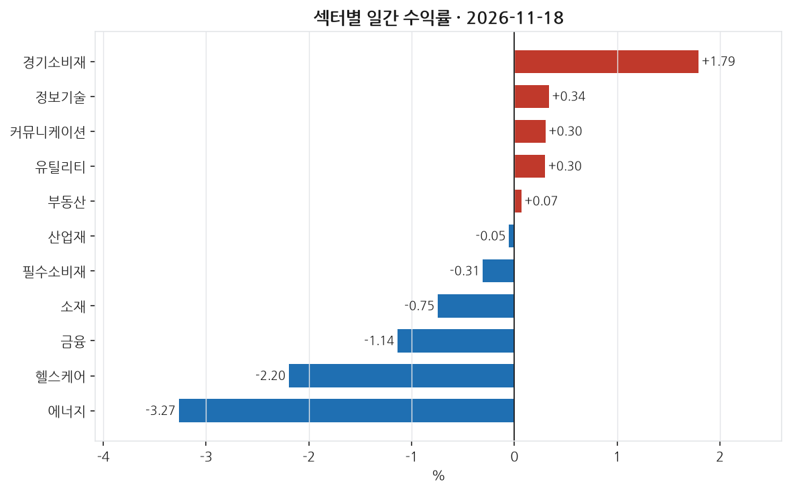
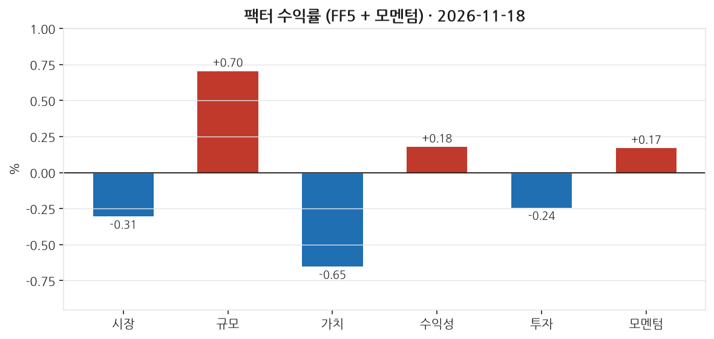
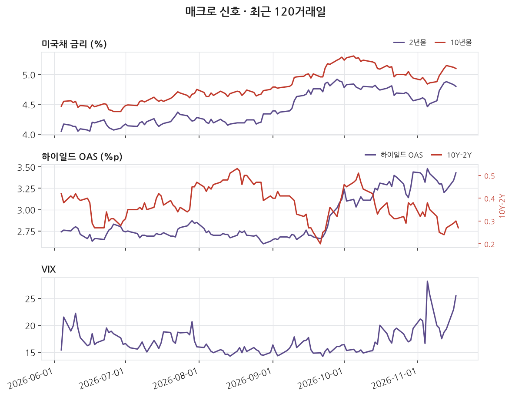
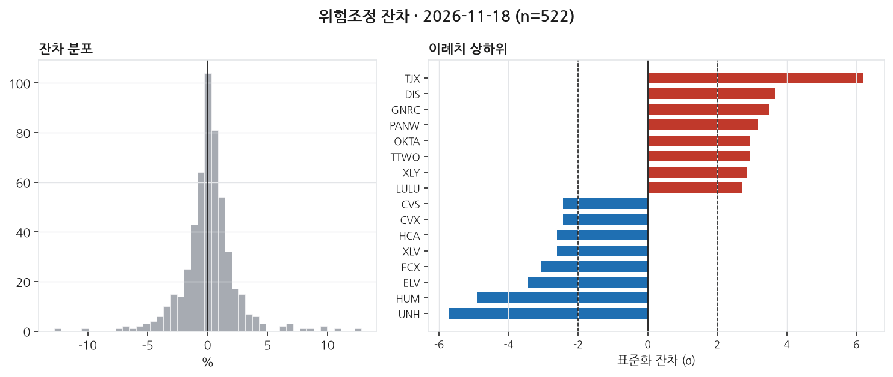

# 2026-11-18 | SPY -0.31% — 이례치 36종목

> 대상 거래일 2026년 11월 18일 (ET) · 발행 2026-11-19 07:00 KST

---

## 1. 무엇이 움직였나

_이 블록은 숫자만 적는다. 해석은 2번으로 넘긴다._

| 지수 | 일간 |
|---|---|
| S&P 500 (SPY) | -0.31% |
| 나스닥 100 (QQQ) | +0.39% |
| 러셀 2000 (IWM) | +0.40% |
| 다우 30 (DIA) | -1.10% |

11개 섹터 중 5개 상승. 최상위 경기소비재 +1.79%, 최하위 에너지 -3.27%. 상하단 폭 5.06%p.

| 신호 | 레벨 | 직전대비 | 기준일 |
|---|---|---|---|
| 2년물 | 4.80 | -3bp | 11-17 (미공개) |
| 10년물 | 5.10 | -2bp | 11-17 (미공개) |
| 10Y-2Y | 0.27 | -3bp | 11-18 |
| 기대인플레(10Y BEI) | 2.19 | -2bp | 11-18 |
| 달러지수 | 122.65 | +0.11 | 11-13 (미공개) |
| VIX | 25.46 | +2.55 | 11-17 (미공개) |
| 하이일드 OAS | 3.43 | +9bp | 11-17 (미공개) |
| EFFR | 3.88 | +0bp | 11-17 (미공개) |

_'미공개'는 해당 거래일 값이 아직 FRED에 공개되지 않아 직전 공개일 기준임을 뜻한다. 확정치가 들어오면 소급 갱신된다._

---

## 2. 무엇이 설명했나

_개별 종목의 등락은 대부분 '그 종목 고유의 사건'이 아니라 시장 전체·규모·가치·모멘텀 같은 **공통 요인(팩터)** 에 대한 노출로 설명된다. 이 블록은 그 공통 요인이 그날 얼마나 움직였는지를 먼저 본다._

이날 시장의 전반적인 움직임은 주식 시장의 하락세가 주도했으나, 소형주의 상대적 우위가 두드러졌다. 시장 팩터는 약간의 하락을 보이며 개별 종목들의 수익 변화보다 시장 전반의 하락 추세에 더 영향을 받았다는 것을 나타냈다. 소형주 우위를 나타내는 규모(SMB) 팩터가 양(+)의 값을 보였고, 가치(HML) 팩터는 음(-)으로, 저평가주보다 성장주가 더 나은 성과를 보였다. 모멘텀은 거의 변화가 없었으나 최근의 추세가 약간 이어진 날이었다.

섹터별로 보면 경기소비재가 상대적으로 높은 상승률을 기록했으며 정보기술 및 커뮤니케이션 섹터는 살짝의 상승세를 보였다. 반면, 에너지와 헬스케어 섹터는 크게 하락하며 눈에 띄는 성과를 보였다. 특히 에너지는 약세가 두드러졌으며, 헬스케어 또한 상당한 하락폭을 기록했다. 이는 단순한 시장 하락 이상의 섹터 특이 요인에 의한 결과로 해석될 수 있다.

개별 종목 중에서는 TJX Companies가 눈에 띄는 잔차를 기록했다. 이러한 잔차는 팩터 노출로 설명되지 않는 부분으로, 경영 및 특정 이벤트 반영 가능성이 있다. Walt Disney Company와 Generac도 눈에 띄게 상승했다. 반면, UnitedHealth Group과 Humana를 포함한 헬스케어 섹터의 여러 기업들이 부진했다. 이는 섹터의 성과 이상으로 개별 기업들의 특수한 요인이 영향을 미쳤을 가능성을 시사한다. 이번 회귀분석의 R²는 제공되지 않아, 종목 간 수익 차이를 충분히 설명하지 못했음을 주의해야 한다. 데이터 측면의 한계도 고려해야 한다.

_**모멘텀(UMD) +0.17%** — 최근 약 1년간 많이 오른 종목을 사고 많이 내린 종목을 파는 가상 포트폴리오의 그날 수익률이다. **양(+)이다. 오르던 종목이 그날도 더 올랐다는 뜻이다(추세 지속). 최근 상승 종목에 몰려 있던 자금에 유리했던 날이다.** 이 팩터를 모형에 넣지 않으면 이 움직임이 잔차에 남아 뉴스 효과로 오인된다._

---

## 3. 설명되지 않은 움직임

_**잔차(residual)** 는 '그 종목이 팩터 노출만으로 움직였다면 이랬을 텐데, 실제로는 이만큼 달랐다'의 차이다. 예를 들어 시장이 -1.5% 빠진 날 어떤 종목이 -1.5% 하락했다면 시장을 따라간 것이라 잔차는 0에 가깝다. 반대로 시장이 빠진 날 +16% 오르면 팩터로 설명되지 않는 큰 양(+)의 잔차가 남는다. 그 남은 부분이 그 종목 고유의 사건 — 실적 발표, 가이던스 수정, M&A 같은 — 을 담고 있을 가능성이 높다. 이 블로그가 뉴스와 맞춰보는 대상이 바로 이 잔차다._

위험모형: ff5_umd · 추정창 250거래일 · 유효 종목 522개. 잔차 표준편차 226bp.

±2σ 이탈: 상방 21개, 하방 15개 (전체 522개 중 6.9%). **z** 는 그 종목의 잔차를 자기 과거 변동성으로 나눈 값이다. z=+3이면 평소 흔들림의 세 배만큼 위로 벗어났다는 뜻이고, 정규분포라면 ±2σ 밖은 약 4.6%만 나온다 — 그보다 많으면 그날 개별 사건이 몰렸거나 수익률 분포의 꼬리가 두껍다는 신호다.

| 종목 | 회사 | 섹터 | 수익률 | 잔차 | z | 같은 날 보도된 뉴스 |
|---|---|---|---|---|---|---|
| TJX | TJX Companies | 경기소비재 | +8.05% | +8.47% | +6.2 | **미설명** |
| DIS | Walt Disney Company (The) | 커뮤니케이션 | +4.63% | +4.82% | +3.7 | **미설명** |
| GNRC | Generac | 산업재 | +9.87% | +10.83% | +3.5 | **미설명** |
| PANW | Palo Alto Networks | 정보기술 | +9.90% | +9.78% | +3.2 | **미설명** |
| OKTA | Okta, Inc. | 정보기술 | +12.07% | +12.82% | +2.9 | **미설명** |
| UNH | UnitedHealth Group | 헬스케어 | -10.21% | -10.17% | -5.7 | **미설명** |
| HUM | Humana | 헬스케어 | -12.98% | -12.79% | -4.9 | **미설명** |
| ELV | Elevance Health | 헬스케어 | -7.63% | -6.98% | -3.4 | **미설명** |
| FCX | Freeport-McMoRan | 소재 | -6.96% | -6.83% | -3.1 | **미설명** |
| XLV | XLV |  | -2.20% | -2.29% | -2.6 | **미설명** |

이례치 상하위 20종목 중 20개는 수집 범위 안에서 매칭되는 뉴스를 찾지 못했다. 뉴스 커버리지 한계이거나, 실제로 뉴스가 아닌 요인일 수 있다. 둘을 구분하지 않고 '뉴스로 설명되지 않는다'고 단정하지 않는다.

---

## 4. 어제 신호 채점

_이 블로그의 존재 이유다. 전날 뉴스 감성으로 종목을 5분위로 나눠 놓고, 그 다음 거래일에 실제로 상위 분위가 하위 분위보다 높은 잔차를 냈는지 채점한다. **맞은 날과 틀린 날을 모두 그대로 남긴다.** 사후에 성공 사례만 고르면 out-of-sample 기록이 아니게 되기 때문이다._

직전 거래일 뉴스 감성(novelty 가중) 5분위 포트폴리오의 당일 실현 잔차:

- 최상위 분위 (n=5): +14.4bp
- 최하위 분위 (n=5): +220.6bp
- 스프레드: **-206.2bp** (방향 불일치)

누적 53거래일: 평균 스프레드 -4.1bp, 방향 적중률 42%, t=-0.40.

동일가중이며 거래비용을 반영하지 않았다. 집행 가능한 전략 수익률이 아니라 신호의 방향성 기록이다.

---

## 5. 다음 거래일 일정

_아래는 다음 거래일에 공개되는 주요 지표다. 여기 있는 항목은 **전 종목의 잔차가 같은 방향으로 움직이기 쉬운 날**을 미리 표시해 둔 것이다. 그런 날은 개별 뉴스 효과와 매크로 충격이 섞여 3번 블록의 해석이 어려워진다(횡단면 상관이 커진다). 전망이 아니라 해석 난이도에 대한 예고다._

| 발표일 | 지표 | 왜 중요한가 |
|---|---|---|
| 2026-11-19 | FOMC 성명 | 정책금리 결정. 전 종목 잔차가 같은 방향으로 움직이는 대표적인 날 |
| 2026-11-19 | 주간 신규 실업수당 청구 | 주 단위로 나오는 유일한 고용 지표. 고빈도 경기 체크 |

_일정은 FRED 릴리스 캘린더 기준이며 시각은 지표마다 다르다. 컨센서스(시장 예상치)는 무료 소스로 확보되지 않아 싣지 않는다._

---

_본 글은 공개 데이터를 자동 수집·분석한 연구 기록이며 투자자문이 아닙니다. 특정 종목의 매수·매도를 권유하지 않으며, 필자는 언급된 종목을 보유하고 있을 수 있습니다. 모든 수치는 발행 시점 기준이며 사후 수정될 수 있습니다._

데이터 출처: Yahoo Finance · FRED (St. Louis Fed) · Kenneth R. French Data Library · SEC EDGAR

생성 커밋: `d686386`