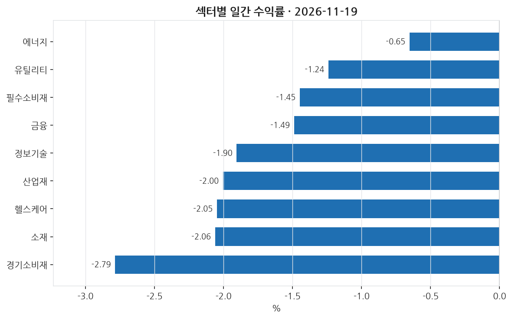
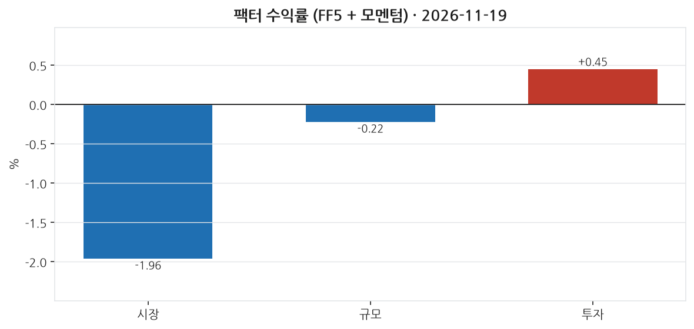
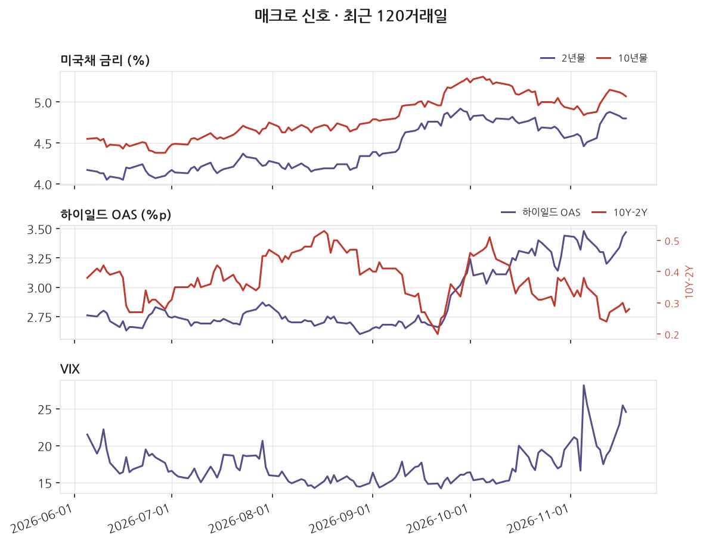

# 2026-11-19 | SPY -1.96%

> 대상 거래일 2026년 11월 19일 (ET) · 발행 2026-11-20 07:00 KST

---

## 1. 무엇이 움직였나

_이 블록은 숫자만 적는다. 해석은 2번으로 넘긴다._

| 지수 | 일간 |
|---|---|
| S&P 500 (SPY) | -1.96% |
| 나스닥 100 (QQQ) | -2.19% |
| 러셀 2000 (IWM) | -2.18% |
| 다우 30 (DIA) | -2.18% |

11개 섹터 중 0개 상승. 최상위 에너지 -0.65%, 최하위 경기소비재 -2.79%. 상하단 폭 2.13%p.

| 신호 | 레벨 | 직전대비 | 기준일 |
|---|---|---|---|
| 2년물 | 4.80 | +0bp | 11-18 (미공개) |
| 10년물 | 5.07 | -3bp | 11-18 (미공개) |
| 10Y-2Y | 0.28 | +1bp | 11-19 |
| 기대인플레(10Y BEI) | 2.16 | -3bp | 11-19 |
| 달러지수 | 122.65 | +0.11 | 11-13 (미공개) |
| VIX | 24.56 | -0.90 | 11-18 (미공개) |
| 하이일드 OAS | 3.47 | +4bp | 11-18 (미공개) |
| EFFR | 3.88 | +0bp | 11-18 (미공개) |

_'미공개'는 해당 거래일 값이 아직 FRED에 공개되지 않아 직전 공개일 기준임을 뜻한다. 확정치가 들어오면 소급 갱신된다._

---

## 2. 무엇이 설명했나

_개별 종목의 등락은 대부분 '그 종목 고유의 사건'이 아니라 시장 전체·규모·가치·모멘텀 같은 **공통 요인(팩터)** 에 대한 노출로 설명된다. 이 블록은 그 공통 요인이 그날 얼마나 움직였는지를 먼저 본다._

시장 팩터는 -1.96%로 큰 폭의 하락을 보였다. 이는 개별 종목 이슈보다는 전체 시장 방향성이 약세로 작용한 날임을 의미한다. 규모 팩터는 -0.22%로 하락하여 대형주로 자금이 몰렸고, 이는 불확실성이 큰 상황에서 상대적으로 안정적인 대형주에 투자자들이 주목했음을 시사한다. 반면, 투자 팩터는 0.45%로 상승하여, 보수적인 자본배분을 하는 기업들이 다른 기업들에 비해 어느 정도 우위를 점했던 것으로 보인다.

섹터별로는 경기소비재가 -2.79%로 가장 큰 하락폭을 기록했으며, 소재와 헬스케어도 각각 -2.06%, -2.04% 하락하며 큰 압박을 받았다. 정보기술, 금융, 필수소비재 같은 전통적인 안정성을 제공할 만한 섹터도 각각 -1.90%, -1.49%, -1.44%로 하락을 면치 못했다. 이는 전반적인 시장 하락과 함께 광범위한 섹터에서의 약세가 동시에 나타났음을 보여준다.

매크로 지표에서는 10년물 국채 수익률이 3 베이시스 포인트 하락했고, 변동성 지수(VIX)는 소폭 하락했다. 이러한 금리와 변동성의 변동이 시장에 미친 영향은 직접적으로 가늠되지 않으며, 토픽 회귀 분석에서도 주목할 만한 통계적 힌트를 얻지 못했다. 이는 데이터 커버리지의 한계로 설명되지 않는 부분이 남았다는 의미다.

---

## 3. 설명되지 않은 움직임

잔차 계산에 필요한 최소 관측치를 확보하지 못했다.

---

## 4. 어제 신호 채점

_이 블로그의 존재 이유다. 전날 뉴스 감성으로 종목을 5분위로 나눠 놓고, 그 다음 거래일에 실제로 상위 분위가 하위 분위보다 높은 잔차를 냈는지 채점한다. **맞은 날과 틀린 날을 모두 그대로 남긴다.** 사후에 성공 사례만 고르면 out-of-sample 기록이 아니게 되기 때문이다._

채점에 필요한 직전 거래일 신호가 부족하다. 누적 데이터가 쌓이면 자동으로 채워진다.

---

## 5. 다음 거래일 일정

_아래는 다음 거래일에 공개되는 주요 지표다. 여기 있는 항목은 **전 종목의 잔차가 같은 방향으로 움직이기 쉬운 날**을 미리 표시해 둔 것이다. 그런 날은 개별 뉴스 효과와 매크로 충격이 섞여 3번 블록의 해석이 어려워진다(횡단면 상관이 커진다). 전망이 아니라 해석 난이도에 대한 예고다._

| 발표일 | 지표 | 왜 중요한가 |
|---|---|---|
| 2026-11-20 | FOMC 성명 | 정책금리 결정. 전 종목 잔차가 같은 방향으로 움직이는 대표적인 날 |
| 2026-11-20 | 주간 신규 실업수당 청구 | 주 단위로 나오는 유일한 고용 지표. 고빈도 경기 체크 |
| 2026-11-24 | 산업생산·설비가동률 | 제조업 실물 활동. 경기 순환 국면 확인 |

_일정은 FRED 릴리스 캘린더 기준이며 시각은 지표마다 다르다. 컨센서스(시장 예상치)는 무료 소스로 확보되지 않아 싣지 않는다._

---

_본 글은 공개 데이터를 자동 수집·분석한 연구 기록이며 투자자문이 아닙니다. 특정 종목의 매수·매도를 권유하지 않으며, 필자는 언급된 종목을 보유하고 있을 수 있습니다. 모든 수치는 발행 시점 기준이며 사후 수정될 수 있습니다._

데이터 출처: Yahoo Finance · FRED (St. Louis Fed) · Kenneth R. French Data Library · SEC EDGAR

생성 커밋: `43b6d6e`