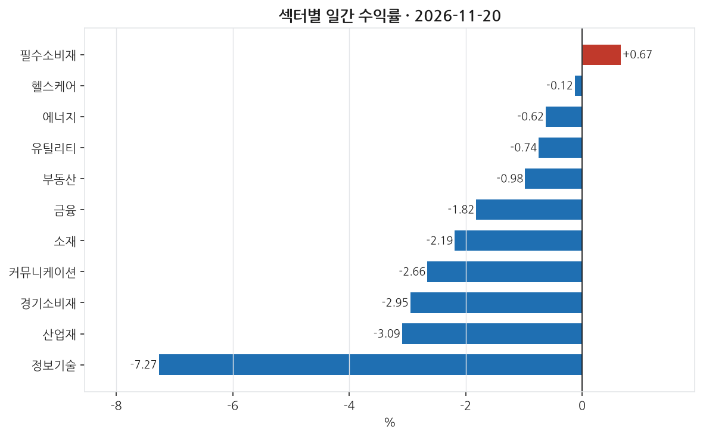
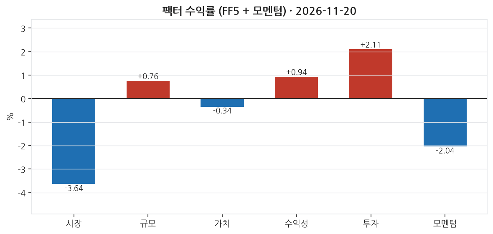
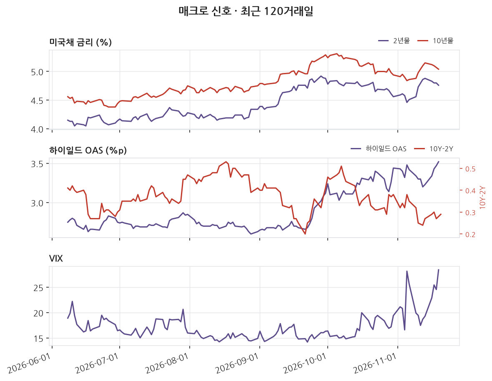
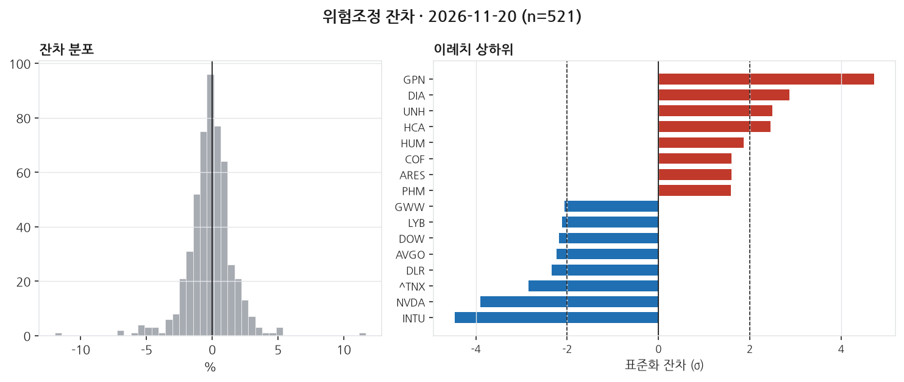

# 2026-11-20 | SPY -3.64% — 이례치 12종목

> 대상 거래일 2026년 11월 20일 (ET) · 발행 2026-11-21 07:00 KST

---

## 1. 무엇이 움직였나

_이 블록은 숫자만 적는다. 해석은 2번으로 넘긴다._

| 지수 | 일간 |
|---|---|
| S&P 500 (SPY) | -3.64% |
| 나스닥 100 (QQQ) | -5.67% |
| 러셀 2000 (IWM) | -2.88% |
| 다우 30 (DIA) | -1.87% |

11개 섹터 중 1개 상승. 최상위 필수소비재 +0.67%, 최하위 정보기술 -7.27%. 상하단 폭 7.94%p.

| 신호 | 레벨 | 직전대비 | 기준일 |
|---|---|---|---|
| 2년물 | 4.76 | -4bp | 11-19 (미공개) |
| 10년물 | 5.04 | -3bp | 11-19 (미공개) |
| 10Y-2Y | 0.29 | +1bp | 11-20 |
| 기대인플레(10Y BEI) | 2.15 | -1bp | 11-20 |
| 달러지수 | 122.65 | +0.11 | 11-13 (미공개) |
| VIX | 28.44 | +3.88 | 11-19 (미공개) |
| 하이일드 OAS | 3.52 | +5bp | 11-19 (미공개) |
| EFFR | 3.88 | +0bp | 11-19 (미공개) |

_'미공개'는 해당 거래일 값이 아직 FRED에 공개되지 않아 직전 공개일 기준임을 뜻한다. 확정치가 들어오면 소급 갱신된다._

---

## 2. 무엇이 설명했나

_개별 종목의 등락은 대부분 '그 종목 고유의 사건'이 아니라 시장 전체·규모·가치·모멘텀 같은 **공통 요인(팩터)** 에 대한 노출로 설명된다. 이 블록은 그 공통 요인이 그날 얼마나 움직였는지를 먼저 본다._

시장은 전체적으로 하락세를 보이며, 시장 팩터는 -0.0364%였다. 이는 대부분의 등락이 시장 전반의 부정적인 방향성에 의해 설명될 수 있음을 시사한다. 모멘텀은 -2.04%로, 최근 상승세가 꺾이고 되돌림이 발생한 날이었다. 이와 같은 움직임은 대형주보다 소형주가 상대적으로 저항력을 보였던 모습을 반영한다(규모 +0.76%).

섹터별로 분산이 뚜렷하게 나타나며, 정보기술 분야가 -7.27%로 가장 큰 타격을 입었다. 반면, 필수소비재는 +0.67% 상승하며 하락장에서 방어적인 모습을 보였다. 전반적인 하락 속에서도 필수소비재가 유일하게 상승한 점은 안전 자산에 대한 선호를 반영할 수 있다.

개별 종목에서는 금융 부문의 Global Payments가 +9.95% 상승하며 잔차 측면에서 눈에 띄는 성과를 보였다. 이는 금융 섹터가 -1.82% 하락한 것과 대조적이다. 같은 섹터의 Intuit, Nvidia, Broadcom은 정보기술 섹터의 부정적 움직임과 함께 잔차가 큰 폭으로 하락했다. 전체 종목의 잔차 분산은 1.74%p로 관측됐으며, 이는 시장의 전반적인 하락세에 비해 개별 종목의 움직임이 다소 독립적임을 보여준다. 주어진 데이터에서는 토픽 회귀 분석의 설명력이 확인되지 않았다. 이는 데이터 커버리지 한계일 수 있으며, 그날의 시장 뉴스와의 상관관계 탐색에 제한이 있을 수 있다.

_**모멘텀(UMD) -2.04%** — 최근 약 1년간 많이 오른 종목을 사고 많이 내린 종목을 파는 가상 포트폴리오의 그날 수익률이다. **음(−)이다. 최근 잘 오르던 종목이 그날 오히려 더 많이 빠졌다는 뜻이다(되돌림). 최근 상승세가 강한 종목을 들고 있었다면 개별 뉴스가 없어도 손실이 났을 날이다.** 이 팩터를 모형에 넣지 않으면 이 움직임이 잔차에 남아 뉴스 효과로 오인된다._

---

## 3. 설명되지 않은 움직임

_**잔차(residual)** 는 '그 종목이 팩터 노출만으로 움직였다면 이랬을 텐데, 실제로는 이만큼 달랐다'의 차이다. 예를 들어 시장이 -1.5% 빠진 날 어떤 종목이 -1.5% 하락했다면 시장을 따라간 것이라 잔차는 0에 가깝다. 반대로 시장이 빠진 날 +16% 오르면 팩터로 설명되지 않는 큰 양(+)의 잔차가 남는다. 그 남은 부분이 그 종목 고유의 사건 — 실적 발표, 가이던스 수정, M&A 같은 — 을 담고 있을 가능성이 높다. 이 블로그가 뉴스와 맞춰보는 대상이 바로 이 잔차다._

위험모형: ff5_umd · 추정창 250거래일 · 유효 종목 521개. 잔차 표준편차 174bp.

±2σ 이탈: 상방 4개, 하방 8개 (전체 521개 중 2.3%). **z** 는 그 종목의 잔차를 자기 과거 변동성으로 나눈 값이다. z=+3이면 평소 흔들림의 세 배만큼 위로 벗어났다는 뜻이고, 정규분포라면 ±2σ 밖은 약 4.6%만 나온다 — 그보다 많으면 그날 개별 사건이 몰렸거나 수익률 분포의 꼬리가 두껍다는 신호다.

| 종목 | 회사 | 섹터 | 수익률 | 잔차 | z | 같은 날 보도된 뉴스 |
|---|---|---|---|---|---|---|
| GPN | Global Payments | 금융 | +9.95% | +11.67% | +4.7 | **미설명** |
| DIA | DIA |  | -1.87% | +1.06% | +2.9 | **미설명** |
| UNH | UnitedHealth Group | 헬스케어 | +2.84% | +4.86% | +2.5 | **미설명** |
| HCA | HCA Healthcare | 헬스케어 | +3.31% | +4.76% | +2.5 | **미설명** |
| HUM | Humana | 헬스케어 | +2.63% | +5.13% | +1.9 | **미설명** |
| INTU | Intuit | 정보기술 | -12.77% | -11.97% | -4.5 | [Intuit’s downbeat outlook deepens Wall Street’s anxi…](https://www.marketwatch.com/story/intuits-downbeat-outlook-deepens-wall-streets-anxiety-about-software-companies-15b878e5?mod=mw_rss_topstories) _MarketWatch Top_ |
| NVDA | Nvidia | 정보기술 | -14.01% | -6.79% | -3.9 | [Nvidia’s stock falls further. It has lost $669 billi…](https://www.marketwatch.com/story/nvidias-stock-falls-further-it-has-lost-611-billion-in-six-trading-days-434af231?mod=mw_rss_topstories) _MarketWatch Top_ |
| ^TNX | ^TNX |  | -2.77% | -2.38% | -2.8 | **미설명** |
| DLR | Digital Realty | 부동산 | -6.64% | -3.85% | -2.3 | **미설명** |
| AVGO | Broadcom | 정보기술 | -12.19% | -4.73% | -2.2 | [Why Micron, Broadcom and other AI stocks gave up the…](https://www.marketwatch.com/story/why-micron-intel-and-other-ai-stocks-are-getting-a-lift-on-thursday-cf6f59f8?mod=mw_rss_topstories) _MarketWatch Top_ |

이례치 상하위 20종목 중 17개는 수집 범위 안에서 매칭되는 뉴스를 찾지 못했다. 뉴스 커버리지 한계이거나, 실제로 뉴스가 아닌 요인일 수 있다. 둘을 구분하지 않고 '뉴스로 설명되지 않는다'고 단정하지 않는다.

---

## 4. 어제 신호 채점

_이 블로그의 존재 이유다. 전날 뉴스 감성으로 종목을 5분위로 나눠 놓고, 그 다음 거래일에 실제로 상위 분위가 하위 분위보다 높은 잔차를 냈는지 채점한다. **맞은 날과 틀린 날을 모두 그대로 남긴다.** 사후에 성공 사례만 고르면 out-of-sample 기록이 아니게 되기 때문이다._

채점에 필요한 직전 거래일 신호가 부족하다. 누적 데이터가 쌓이면 자동으로 채워진다.

---

## 5. 다음 거래일 일정

_아래는 다음 거래일에 공개되는 주요 지표다. 여기 있는 항목은 **전 종목의 잔차가 같은 방향으로 움직이기 쉬운 날**을 미리 표시해 둔 것이다. 그런 날은 개별 뉴스 효과와 매크로 충격이 섞여 3번 블록의 해석이 어려워진다(횡단면 상관이 커진다). 전망이 아니라 해석 난이도에 대한 예고다._

| 발표일 | 지표 | 왜 중요한가 |
|---|---|---|
| 2026-11-21 | FOMC 성명 | 정책금리 결정. 전 종목 잔차가 같은 방향으로 움직이는 대표적인 날 |
| 2026-11-24 | 산업생산·설비가동률 | 제조업 실물 활동. 경기 순환 국면 확인 |
| 2026-11-25 | GDP | 성장률 확정치·수정치. 경기 국면 판단의 기준선 |
| 2026-11-25 | 개인소득·지출 (PCE 물가 포함) | 연준이 공식 목표로 쓰는 물가지표가 여기 들어 있다 |
| 2026-11-25 | 주간 신규 실업수당 청구 | 주 단위로 나오는 유일한 고용 지표. 고빈도 경기 체크 |
| 2026-11-25 | 주택 착공·허가 | 금리에 가장 민감한 실물 부문. 건자재 종목에 직접 반영된다 |

_일정은 FRED 릴리스 캘린더 기준이며 시각은 지표마다 다르다. 컨센서스(시장 예상치)는 무료 소스로 확보되지 않아 싣지 않는다._

---

_본 글은 공개 데이터를 자동 수집·분석한 연구 기록이며 투자자문이 아닙니다. 특정 종목의 매수·매도를 권유하지 않으며, 필자는 언급된 종목을 보유하고 있을 수 있습니다. 모든 수치는 발행 시점 기준이며 사후 수정될 수 있습니다._

데이터 출처: Yahoo Finance · FRED (St. Louis Fed) · Kenneth R. French Data Library · SEC EDGAR

생성 커밋: `8c3c6c9`