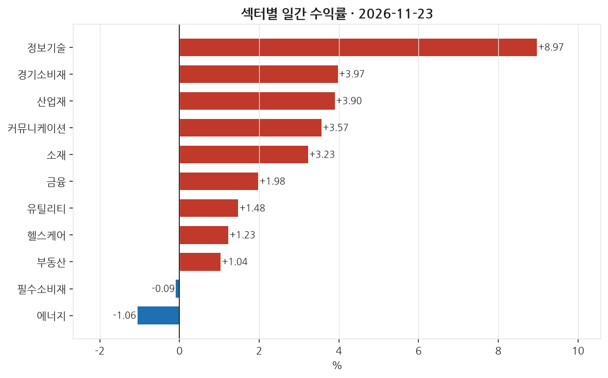
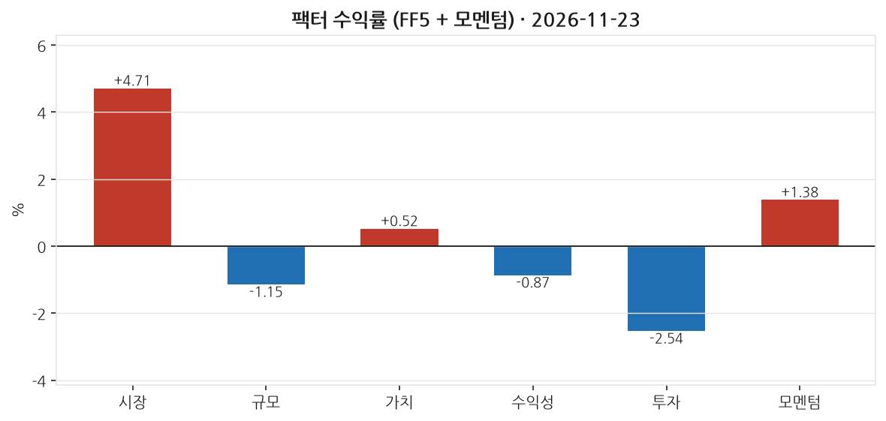
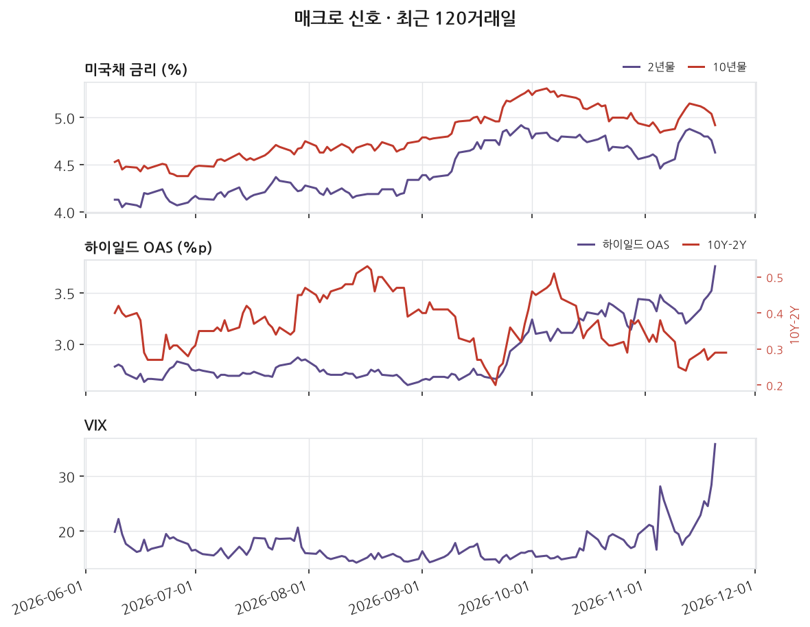
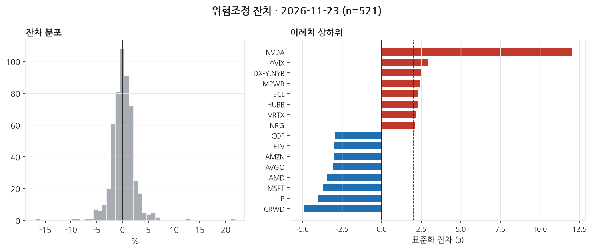

# 2026-11-23 | SPY +4.71% — 이례치 28종목

> 대상 거래일 2026년 11월 23일 (ET) · 발행 2026-11-24 07:00 KST

---

## 1. 무엇이 움직였나

_이 블록은 숫자만 적는다. 해석은 2번으로 넘긴다._

| 지수 | 일간 |
|---|---|
| S&P 500 (SPY) | +4.71% |
| 나스닥 100 (QQQ) | +7.00% |
| 러셀 2000 (IWM) | +3.56% |
| 다우 30 (DIA) | +3.06% |

11개 섹터 중 9개 상승. 최상위 정보기술 +8.97%, 최하위 에너지 -1.06%. 상하단 폭 10.03%p.

| 신호 | 레벨 | 직전대비 | 기준일 |
|---|---|---|---|
| 2년물 | 4.63 | -13bp | 11-20 (미공개) |
| 10년물 | 4.92 | -12bp | 11-20 (미공개) |
| 10Y-2Y | 0.29 | +0bp | 11-23 |
| 기대인플레(10Y BEI) | 2.13 | -2bp | 11-23 |
| 달러지수 | 123.60 | +0.07 | 11-20 (미공개) |
| VIX | 35.89 | +7.45 | 11-20 (미공개) |
| 하이일드 OAS | 3.76 | +24bp | 11-20 (미공개) |
| EFFR | 3.88 | +0bp | 11-20 (미공개) |

_'미공개'는 해당 거래일 값이 아직 FRED에 공개되지 않아 직전 공개일 기준임을 뜻한다. 확정치가 들어오면 소급 갱신된다._

---

## 2. 무엇이 설명했나

_개별 종목의 등락은 대부분 '그 종목 고유의 사건'이 아니라 시장 전체·규모·가치·모멘텀 같은 **공통 요인(팩터)** 에 대한 노출로 설명된다. 이 블록은 그 공통 요인이 그날 얼마나 움직였는지를 먼저 본다._

시장이 전체적으로 4.7% 반등하며 긍정적인 흐름을 보인 가운데, 소형주보다는 대형주가 강세를 보였다. 시장 팩터(mkt_rf)가 약 4.7% 상승하며 대부분의 등락을 시장 전반적인 방향성 하나로 설명하나, 소형주 대비 대형주 선호를 나타내는 규모 팩터(smb)는 약간의 하락을 보여 대형주가 소형주를 약간 앞섰다. 가치주와 성장주 간 차이는 거의 없었고, 영업수익성 높은 기업보다는 낮은 기업이, 보수적 자본배분 기업보다는 공격적 자본배분 기업이 우위를 점한 날이었다.

섹터별로는 정보기술 섹터가 8.97% 상승하며 가장 큰 폭의 상승을 기록했다. 세부 종목 중 Nvidia는 31.5% 상승했으며, 팩터 노출로 설명한 뒤 남은 잔차가 21.8%p에 달해 그만큼 개별 이슈에 영향받은 것으로 보인다. 반면, 필수소비재와 에너지 섹터는 각각 소폭 하락하며 상대적으로 부진한 섹터였다. 지수 변동성을 나타내는 VIX는 25.8% 하락, 정보기술 섹터의 강세와 더불어 시장의 변동성을 어느 정도 해소한 것으로 관측됐다.

종목별로는, 정보기술의 Nvidia가 가장 두드러진 성과를 보인 반면, 정보기술 소속의 CrowdStrike, International Paper, 그리고 Microsoft는 팩터 노출로 설명한 후에도 각각 크고 작은 음수 잔차를 기록하여 부진했다. 종합적으로, 이날의 수익률은 개별 종목 및 섹터의 변화보다는 시장 전반적인 상승으로 설명되는 부분이 크다. 아쉽게도 토픽 회귀의 설명력은 제공되지 않지만, 전반적인 시장의 흐름을 감안하면 지수 상품 대비 개별 이슈의 영향이 상대적으로 적었음을 짐작할 수 있다.

_**모멘텀(UMD) +1.38%** — 최근 약 1년간 많이 오른 종목을 사고 많이 내린 종목을 파는 가상 포트폴리오의 그날 수익률이다. **양(+)이다. 오르던 종목이 그날도 더 올랐다는 뜻이다(추세 지속). 최근 상승 종목에 몰려 있던 자금에 유리했던 날이다.** 이 팩터를 모형에 넣지 않으면 이 움직임이 잔차에 남아 뉴스 효과로 오인된다._

---

## 3. 설명되지 않은 움직임

_**잔차(residual)** 는 '그 종목이 팩터 노출만으로 움직였다면 이랬을 텐데, 실제로는 이만큼 달랐다'의 차이다. 예를 들어 시장이 -1.5% 빠진 날 어떤 종목이 -1.5% 하락했다면 시장을 따라간 것이라 잔차는 0에 가깝다. 반대로 시장이 빠진 날 +16% 오르면 팩터로 설명되지 않는 큰 양(+)의 잔차가 남는다. 그 남은 부분이 그 종목 고유의 사건 — 실적 발표, 가이던스 수정, M&A 같은 — 을 담고 있을 가능성이 높다. 이 블로그가 뉴스와 맞춰보는 대상이 바로 이 잔차다._

위험모형: ff5_umd · 추정창 250거래일 · 유효 종목 521개. 잔차 표준편차 241bp.

±2σ 이탈: 상방 9개, 하방 19개 (전체 521개 중 5.4%). **z** 는 그 종목의 잔차를 자기 과거 변동성으로 나눈 값이다. z=+3이면 평소 흔들림의 세 배만큼 위로 벗어났다는 뜻이고, 정규분포라면 ±2σ 밖은 약 4.6%만 나온다 — 그보다 많으면 그날 개별 사건이 몰렸거나 수익률 분포의 꼬리가 두껍다는 신호다.

| 종목 | 회사 | 섹터 | 수익률 | 잔차 | z | 같은 날 보도된 뉴스 |
|---|---|---|---|---|---|---|
| NVDA | Nvidia | 정보기술 | +31.48% | +21.79% | +12.1 | [Nvidia’s stock clinches a stretch of weekly losses n…](https://www.marketwatch.com/story/nvidias-stock-heads-for-a-stretch-of-weekly-losses-unseen-since-2008-91aba9a6?mod=mw_rss_topstories) _MarketWatch Top_ |
| ^VIX | ^VIX |  | -25.83% | +13.04% | +3.0 | **미설명** |
| DX-Y.NYB | DX-Y.NYB |  | +0.49% | +0.75% | +2.5 | **미설명** |
| MPWR | Monolithic Power Systems | 정보기술 | +16.80% | +6.16% | +2.4 | **미설명** |
| ECL | Ecolab | 소재 | +3.80% | +2.41% | +2.3 | **미설명** |
| CRWD | CrowdStrike | 정보기술 | -8.92% | -16.84% | -4.9 | **미설명** |
| IP | International Paper | 소재 | -4.55% | -9.01% | -4.0 | **미설명** |
| MSFT | Microsoft | 정보기술 | +1.65% | -5.67% | -3.7 | **미설명** |
| AMD | Advanced Micro Devices | 정보기술 | +6.85% | -9.22% | -3.4 | [8-K - ADVANCED MICRO DEVICES INC (0000002488) (Filer…](https://www.sec.gov/Archives/edgar/data/2488/000000248826000218/0000002488-26-000218-index.htm) _SEC 8-K_ |
| AVGO | Broadcom | 정보기술 | +3.00% | -6.57% | -3.1 | **미설명** |

이례치 상하위 20종목 중 18개는 수집 범위 안에서 매칭되는 뉴스를 찾지 못했다. 뉴스 커버리지 한계이거나, 실제로 뉴스가 아닌 요인일 수 있다. 둘을 구분하지 않고 '뉴스로 설명되지 않는다'고 단정하지 않는다.

---

## 4. 어제 신호 채점

_이 블로그의 존재 이유다. 전날 뉴스 감성으로 종목을 5분위로 나눠 놓고, 그 다음 거래일에 실제로 상위 분위가 하위 분위보다 높은 잔차를 냈는지 채점한다. **맞은 날과 틀린 날을 모두 그대로 남긴다.** 사후에 성공 사례만 고르면 out-of-sample 기록이 아니게 되기 때문이다._

채점에 필요한 직전 거래일 신호가 부족하다. 누적 데이터가 쌓이면 자동으로 채워진다.

---

## 5. 다음 거래일 일정

_아래는 다음 거래일에 공개되는 주요 지표다. 여기 있는 항목은 **전 종목의 잔차가 같은 방향으로 움직이기 쉬운 날**을 미리 표시해 둔 것이다. 그런 날은 개별 뉴스 효과와 매크로 충격이 섞여 3번 블록의 해석이 어려워진다(횡단면 상관이 커진다). 전망이 아니라 해석 난이도에 대한 예고다._

| 발표일 | 지표 | 왜 중요한가 |
|---|---|---|
| 2026-11-24 | FOMC 성명 | 정책금리 결정. 전 종목 잔차가 같은 방향으로 움직이는 대표적인 날 |
| 2026-11-24 | 산업생산·설비가동률 | 제조업 실물 활동. 경기 순환 국면 확인 |
| 2026-11-25 | GDP | 성장률 확정치·수정치. 경기 국면 판단의 기준선 |
| 2026-11-25 | 개인소득·지출 (PCE 물가 포함) | 연준이 공식 목표로 쓰는 물가지표가 여기 들어 있다 |
| 2026-11-25 | 주간 신규 실업수당 청구 | 주 단위로 나오는 유일한 고용 지표. 고빈도 경기 체크 |
| 2026-11-25 | 주택 착공·허가 | 금리에 가장 민감한 실물 부문. 건자재 종목에 직접 반영된다 |

_일정은 FRED 릴리스 캘린더 기준이며 시각은 지표마다 다르다. 컨센서스(시장 예상치)는 무료 소스로 확보되지 않아 싣지 않는다._

---

_본 글은 공개 데이터를 자동 수집·분석한 연구 기록이며 투자자문이 아닙니다. 특정 종목의 매수·매도를 권유하지 않으며, 필자는 언급된 종목을 보유하고 있을 수 있습니다. 모든 수치는 발행 시점 기준이며 사후 수정될 수 있습니다._

데이터 출처: Yahoo Finance · FRED (St. Louis Fed) · Kenneth R. French Data Library · SEC EDGAR

생성 커밋: `e5c1be9`