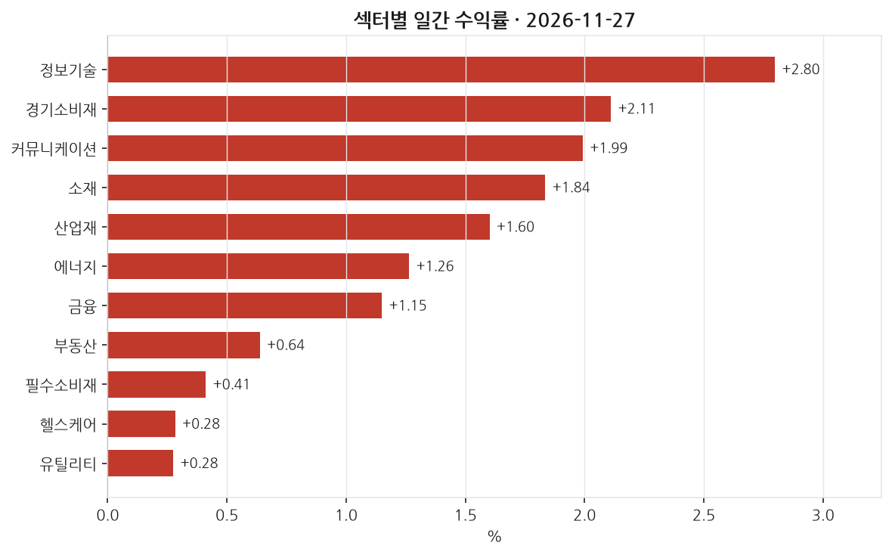
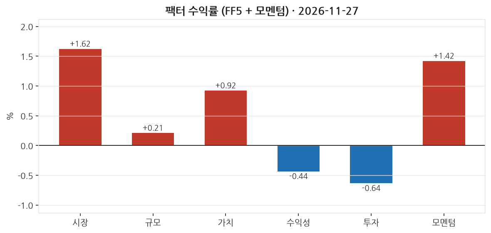
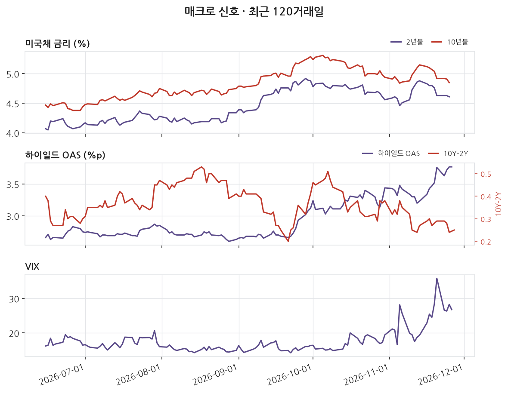
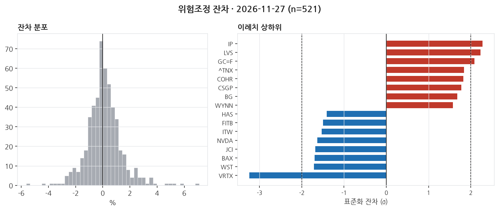

# 2026-11-27 | SPY +1.62% — 이례치 4종목

> 대상 거래일 2026년 11월 27일 (ET) · 발행 2026-11-28 07:00 KST

---

## 1. 무엇이 움직였나

_이 블록은 숫자만 적는다. 해석은 2번으로 넘긴다._

| 지수 | 일간 |
|---|---|
| S&P 500 (SPY) | +1.62% |
| 나스닥 100 (QQQ) | +2.69% |
| 러셀 2000 (IWM) | +1.83% |
| 다우 30 (DIA) | +1.26% |

11개 섹터 중 11개 상승. 최상위 정보기술 +2.80%, 최하위 유틸리티 +0.28%. 상하단 폭 2.52%p.

| 신호 | 레벨 | 직전대비 | 기준일 |
|---|---|---|---|
| 2년물 | 4.61 | -2bp | 11-25 (미공개) |
| 10년물 | 4.85 | -6bp | 11-25 (미공개) |
| 10Y-2Y | 0.25 | +1bp | 11-27 |
| 기대인플레(10Y BEI) | 2.15 | +3bp | 11-27 |
| 달러지수 | 123.60 | +0.07 | 11-20 (미공개) |
| VIX | 26.80 | -1.49 | 11-26 (미공개) |
| 하이일드 OAS | 3.77 | +0bp | 11-26 (미공개) |
| EFFR | 3.88 | +0bp | 11-26 (미공개) |

_'미공개'는 해당 거래일 값이 아직 FRED에 공개되지 않아 직전 공개일 기준임을 뜻한다. 확정치가 들어오면 소급 갱신된다._

---

## 2. 무엇이 설명했나

_개별 종목의 등락은 대부분 '그 종목 고유의 사건'이 아니라 시장 전체·규모·가치·모멘텀 같은 **공통 요인(팩터)** 에 대한 노출로 설명된다. 이 블록은 그 공통 요인이 그날 얼마나 움직였는지를 먼저 본다._

그날 팩터 동향을 보면, 시장 초과수익(MKT)이 1.6%로 가장 크게 나타나며 그날 주식시장 등락의 대부분이 시장 전반의 방향성에 기인했음을 시사한다. 모멘텀 팩터(UMD)는 1.42%로 상승했으며, 이는 최근 오르던 종목이 더욱 상승했음을 뜻한다. 다른 팩터의 경우, 규모(SMB)는 소형주가 대형주를 소폭 앞섰고, 가치(HML) 팩터는 저평가주(가치주)가 약간 우위였다. 반면 수익성(RMW) 및 투자(CMA) 팩터는 각각 영업수익성과 보수적 자본 배분 선호가 약했던 날임을 나타내며 마이너스를 기록했다.

섹터에서는 정보기술 분야가 2.8% 상승해 가장 두드러진 성과를 보였다. 이는 다른 섹터들에 비해 큰 수익률을 기록한 것으로, 상승세가 고르게 나타난 시장 상황에서도 특히 주목할 만한 부분이다. 한편, 필수소비재와 헬스케어 부문은 상대적으로 낮은 수익률을 기록하며 소폭 상승했다.

개별 종목에서는 정보기술 분야의 Coherent Corp.(COHR)가 +14.07% 수익률로 두드러졌고, 잔차(팩터 노출로 설명한 뒤 남은 부분)가 +7.09%p로 크다. 반면 헬스케어 부문의 Vertex Pharmaceuticals(VRTX)는 -5.24%로 가장 부진했으며, 잔차 역시 -5.63%p로 큰 음수를 기록해 팩터 모델로 설명되지 않는 주가 부진이 존재했다. 주어진 데이터의 제한적인 커버리지를 감안하면 이러한 미설명 부분은 주의 깊게 살펴봐야 할 여지가 있다.

_**모멘텀(UMD) +1.42%** — 최근 약 1년간 많이 오른 종목을 사고 많이 내린 종목을 파는 가상 포트폴리오의 그날 수익률이다. **양(+)이다. 오르던 종목이 그날도 더 올랐다는 뜻이다(추세 지속). 최근 상승 종목에 몰려 있던 자금에 유리했던 날이다.** 이 팩터를 모형에 넣지 않으면 이 움직임이 잔차에 남아 뉴스 효과로 오인된다._

---

## 3. 설명되지 않은 움직임

_**잔차(residual)** 는 '그 종목이 팩터 노출만으로 움직였다면 이랬을 텐데, 실제로는 이만큼 달랐다'의 차이다. 예를 들어 시장이 -1.5% 빠진 날 어떤 종목이 -1.5% 하락했다면 시장을 따라간 것이라 잔차는 0에 가깝다. 반대로 시장이 빠진 날 +16% 오르면 팩터로 설명되지 않는 큰 양(+)의 잔차가 남는다. 그 남은 부분이 그 종목 고유의 사건 — 실적 발표, 가이던스 수정, M&A 같은 — 을 담고 있을 가능성이 높다. 이 블로그가 뉴스와 맞춰보는 대상이 바로 이 잔차다._

위험모형: ff5_umd · 추정창 250거래일 · 유효 종목 521개. 잔차 표준편차 131bp.

±2σ 이탈: 상방 3개, 하방 1개 (전체 521개 중 0.8%). **z** 는 그 종목의 잔차를 자기 과거 변동성으로 나눈 값이다. z=+3이면 평소 흔들림의 세 배만큼 위로 벗어났다는 뜻이고, 정규분포라면 ±2σ 밖은 약 4.6%만 나온다 — 그보다 많으면 그날 개별 사건이 몰렸거나 수익률 분포의 꼬리가 두껍다는 신호다.

| 종목 | 회사 | 섹터 | 수익률 | 잔차 | z | 같은 날 보도된 뉴스 |
|---|---|---|---|---|---|---|
| IP | International Paper | 소재 | +6.89% | +5.34% | +2.3 | [8-K - INTERNATIONAL PAPER CO /NEW/ (0000051434) (Fil…](https://www.sec.gov/Archives/edgar/data/51434/000162828026075971/0001628280-26-075971-index.htm) _SEC 8-K_ |
| LVS | Las Vegas Sands | 경기소비재 | +3.50% | +3.58% | +2.2 | **미설명** |
| GC=F | GC=F |  | +3.75% | +3.10% | +2.1 | **미설명** |
| ^TNX | ^TNX |  | +1.82% | +1.55% | +1.8 | **미설명** |
| COHR | Coherent Corp. | 정보기술 | +14.07% | +7.09% | +1.8 | **미설명** |
| VRTX | Vertex Pharmaceuticals | 헬스케어 | -5.24% | -5.63% | -3.2 | **미설명** |
| WST | West Pharmaceutical Services | 헬스케어 | -1.82% | -3.11% | -1.7 | **미설명** |
| BAX | Baxter International | 헬스케어 | -1.69% | -3.49% | -1.7 | **미설명** |
| JCI | Johnson Controls | 산업재 | +0.48% | -2.42% | -1.7 | **미설명** |
| NVDA | Nvidia | 정보기술 | +0.80% | -3.77% | -1.6 | [Nvidia’s stock has given back a big chunk of Monday’…](https://www.marketwatch.com/story/nvidias-stock-is-giving-back-more-than-half-of-mondays-rally-as-dip-buyers-cash-in-ee4fa52c?mod=mw_rss_topstories) _MarketWatch Top_ |

이례치 상하위 20종목 중 18개는 수집 범위 안에서 매칭되는 뉴스를 찾지 못했다. 뉴스 커버리지 한계이거나, 실제로 뉴스가 아닌 요인일 수 있다. 둘을 구분하지 않고 '뉴스로 설명되지 않는다'고 단정하지 않는다.

---

## 4. 어제 신호 채점

_이 블로그의 존재 이유다. 전날 뉴스 감성으로 종목을 5분위로 나눠 놓고, 그 다음 거래일에 실제로 상위 분위가 하위 분위보다 높은 잔차를 냈는지 채점한다. **맞은 날과 틀린 날을 모두 그대로 남긴다.** 사후에 성공 사례만 고르면 out-of-sample 기록이 아니게 되기 때문이다._

채점에 필요한 직전 거래일 신호가 부족하다. 누적 데이터가 쌓이면 자동으로 채워진다.

---

## 5. 다음 거래일 일정

_아래는 다음 거래일에 공개되는 주요 지표다. 여기 있는 항목은 **전 종목의 잔차가 같은 방향으로 움직이기 쉬운 날**을 미리 표시해 둔 것이다. 그런 날은 개별 뉴스 효과와 매크로 충격이 섞여 3번 블록의 해석이 어려워진다(횡단면 상관이 커진다). 전망이 아니라 해석 난이도에 대한 예고다._

| 발표일 | 지표 | 왜 중요한가 |
|---|---|---|
| 2026-11-28 | FOMC 성명 | 정책금리 결정. 전 종목 잔차가 같은 방향으로 움직이는 대표적인 날 |
| 2026-12-01 | JOLTS 구인건수 | 노동 수요의 강도. 임금 상승 압력 판단에 쓰인다 |
| 2026-12-02 | GDP | 성장률 확정치·수정치. 경기 국면 판단의 기준선 |

_일정은 FRED 릴리스 캘린더 기준이며 시각은 지표마다 다르다. 컨센서스(시장 예상치)는 무료 소스로 확보되지 않아 싣지 않는다._

---

_본 글은 공개 데이터를 자동 수집·분석한 연구 기록이며 투자자문이 아닙니다. 특정 종목의 매수·매도를 권유하지 않으며, 필자는 언급된 종목을 보유하고 있을 수 있습니다. 모든 수치는 발행 시점 기준이며 사후 수정될 수 있습니다._

데이터 출처: Yahoo Finance · FRED (St. Louis Fed) · Kenneth R. French Data Library · SEC EDGAR

생성 커밋: `9effd09`